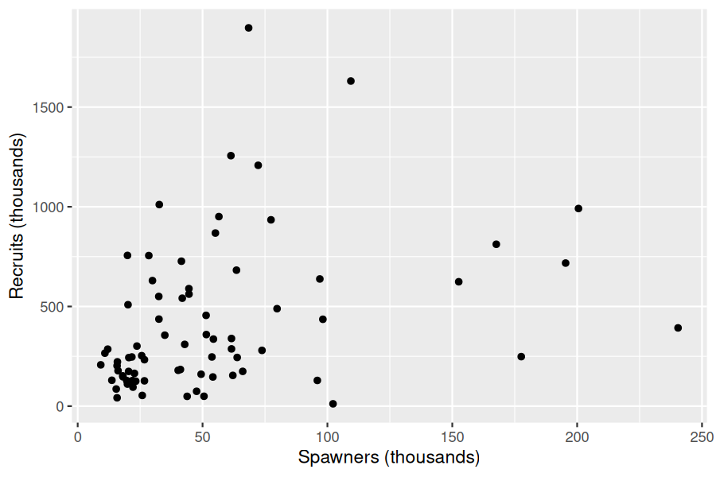
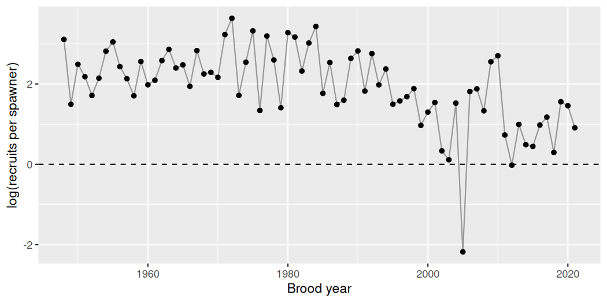
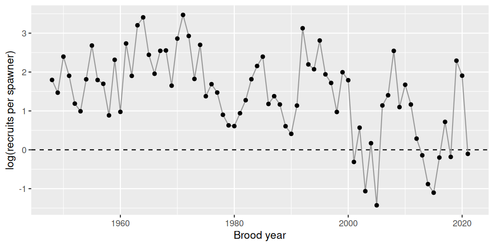

:::::::::::::::::::::::::::::::::::::::: questions

- What questions can a model of spawners and recruits answer?
- What is in the sockeye salmon data, and in what units?
- What will I be able to produce by the end of the workshop?

::::::::::::::::::::::::::::::::::::::::::::::::::

:::::::::::::::::::::::::::::::::::::::: objectives

- Describe each column of `sockeye.csv`, including its units.
- Calculate log recruits per spawner and plot it against brood year for one stock.
- Identify the rows of the model report card and the episode that teaches each.

::::::::::::::::::::::::::::::::::::::::::::::::::


## Why Write Your Own Model?

Formula functions such as `lm()` and `glm()` fit many models, but they cannot write every model you need.
You may need a curve of your own, a quantity that drifts over time, groups that share information, or a forecast with an honest interval.
[RTMB](../learners/reference.md#glossary) lets you write the model as an ordinary R function.
It fits the model fast, gives [standard errors](../learners/reference.md#glossary) and handles [random effects](../learners/reference.md#glossary): sets of related unknown values, such as one value for each year.

The question behind this lesson is a general one: how does output per individual depend on density, and is that relationship stable over time?
We answer it for salmon, where the output is recruits per spawner and the density is the number of spawners.

## Salmon in One Minute

{
alt="Diagram of the sockeye salmon life cycle as a loop. Adults spawn in a river in the brood year and then die; eggs hatch in the river gravel; young fish spend about a year in a lake; they migrate to the ocean; two to three years later the adults return to the river, and some are caught on the way. Recruits are all the adults produced by one brood year's spawners, whether caught or returning to spawn. The returning adults become the next spawners."
}

Sockeye salmon hatch in rivers, grow in lakes and then at sea, and come back to their home river to spawn once and die.
Five terms describe the data:

- A [stock](../learners/reference.md#glossary) is a group of salmon that spawn in the same place at the same time of year.
  The data hold 19 stocks from the Fraser River in British Columbia, Canada.
- The [brood year](../learners/reference.md#glossary) is the year in which the parent fish spawned.
- [Spawners](../learners/reference.md#glossary) are the adult fish that spawned in a brood year.
- [Recruits](../learners/reference.md#glossary) are all the adult fish produced by one brood year's spawners, whether caught in a fishery or returning to spawn.
  They come back over several calendar years, but each one is counted under its parents' brood year.
- [Recruits per spawner](../learners/reference.md#glossary), written R/S, is recruits divided by spawners: how many adults each spawner produced.
  Above 1, the next generation was larger than its parents; below 1, it was smaller.

## The Data

The lesson uses two files.
The second one holds an index of ocean conditions, the [North Pacific Gyre Oscillation (NPGO)](../learners/reference.md#glossary), which Episode 9 adds to a model.

Table: The two data files and their columns.

| File | Column | Meaning | Units |
|:-------|:---------|:-----------------------|:---------|
| `sockeye.csv` | `stock` | one of 19 Fraser River sockeye salmon stocks | none |
| | `management_unit` | Early Stuart (1 stock), Early Summer (7), Summer (6), Late (5) | none |
| | `brood_year` | year the parents spawned, 1948-2022 | year |
| | `spawners` | adults that spawned in the brood year | thousands of fish |
| | `recruits` | adult offspring produced by those spawners (caught or returning), all ages | thousands of fish |
| `npgo.csv` | `year` | calendar year, 1950-2026 | year |
| | `npgo` | NPGO index of ocean conditions; higher values usually mean more food for young salmon | index (mean -0.18, standard deviation 1.05) |

`sockeye.csv` has one row for each stock and brood year, with no zeros and no missing values.
Not every stock covers the whole period: eight stocks start after 1948, a few have gaps, and only Harrison has data for brood year 2022.
If you did not download the files during [Setup](../learners/setup.md), save [the sockeye salmon data (sockeye.csv)](data/sockeye.csv) and [the ocean index data (npgo.csv)](data/npgo.csv) in the `data/` folder of your project.

:::::::::::::::::::::::::::::::::::::::: caution

### Units

Spawners and recruits are in **thousands of fish**.
A spawner count of 9.242 means 9242 fish.
Write the units every time you report a number: "122 thousand spawners", not "122".

::::::::::::::::::::::::::::::::::::::::::::::::::

::::::::::::::::::::::::::::::::::::::::::::::::::::::::::::::::::::: instructor

Before the first chunk, check that every learner has a project with `data/` and `files/` folders and three empty scripts: `my-recipes.R`, `stellako.R` and `upper-pitt-river.R`.
Show where the code handout is (`files/code-handout.R` on the lesson website): it collects the recipe code of every episode.
Keep this episode to 25 minutes and do not introduce models yet; the Quick Start does that next.

::::::::::::::::::::::::::::::::::::::::::::::::::::::::::::::::::::::::::::::::

Open your project, then load two packages and read the salmon data:


``` r
library(dplyr)
```

``` output

Attaching package: 'dplyr'
```

``` output
The following objects are masked from 'package:stats':

    filter, lag
```

``` output
The following objects are masked from 'package:base':

    intersect, setdiff, setequal, union
```

``` r
library(ggplot2)
sockeye <- read.csv("data/sockeye.csv")
head(sockeye)
```

``` output
       stock management_unit brood_year spawners recruits
1 Birkenhead            Late       1948   54.755  191.990
2 Birkenhead            Late       1949   43.328  237.158
3 Birkenhead            Late       1950   41.370  214.749
4 Birkenhead            Late       1951   13.589  173.801
5 Birkenhead            Late       1952   24.744  213.941
6 Birkenhead            Late       1953   16.287  118.877
```

``` r
distinct(sockeye, management_unit, stock) %>% count(management_unit)
```

``` output
  management_unit n
1    Early Stuart 1
2    Early Summer 7
3            Late 5
4          Summer 6
```

The messages from `library(dplyr)` are normal: they say that dplyr has its own versions of a few functions, such as `filter()`.

Each row of `sockeye` is one stock in one brood year.
The first row says that in 1948, about 54.8 thousand Birkenhead sockeye spawned, and they produced about 192 thousand recruits.
`distinct()` keeps one row for each stock, and `count()` counts the stocks in each [management unit](../learners/reference.md#glossary), a group of stocks that return at a similar time and are managed together.
Early Stuart has one stock, Early Summer seven, Late five and Summer six.

:::::::::::::::::::::::::::::::::::::::: callout

### Where the Data Come From

The data are spawner and recruit estimates for 19 Fraser River sockeye salmon stocks, brood years 1948-2022, in thousands of fish, plus the NPGO index.
They were supplied with the Pacific Salmon Commission RTMB workshop (November 2026), and described there as "not necessarily official numbers".
The script `scripts/prepare-data.R` in the lesson's repository records every cleaning step.

These stocks matter to First Nations and to commercial and recreational fisheries.
The lesson uses them to teach methods; nothing in it is management advice.
It follows the [CARE principles for Indigenous data governance](https://www.gida-global.org/care): collective benefit, authority to control, responsibility and ethics.

::::::::::::::::::::::::::::::::::::::::::::::::::

## Recipe: One Stock and Its Recruits per Spawner

**Use it when:** you want to work with one stock.

**Ingredients:** the `sockeye` data frame and the name of a stock.


``` r
my_stock <- sockeye %>%
  filter(stock == "Stellako") %>%
  mutate(logRS = log(recruits / spawners))
nrow(my_stock)
```

``` output
[1] 74
```

``` r
range(my_stock$logRS)
```

``` output
[1] -2.176904  3.635427
```

`filter()` keeps the rows of one stock, and `mutate()` adds the column `logRS`: the log of recruits per spawner, which we write log(R/S).
Change the name in quotes to work with another stock.
We call this data frame `my_stock` throughout the lesson.

**Check it worked:** `nrow(my_stock)` is 74, and `range(my_stock$logRS)` runs from -2.18 to 3.64.

:::::::::::::::::::::::::::::::::::::::: challenge

### Challenge 1: What Does Zero Mean? (3 minutes)

In one brood year, log(R/S) = 0.
What happened?

- **(a)** No recruits were produced.
- **(b)** Each spawner produced one recruit: the stock exactly replaced itself.
- **(c)** The value is missing.
- **(d)** There were 1 thousand recruits.

:::::::::::::::::::::::: solution

The answer is (b).
`log(1)` is 0, so log(R/S) = 0 means R/S = 1: recruits equalled spawners.

- **(a)** is wrong: no recruits would give `log(0)`, which is minus infinity (`-Inf` in R), not 0.
- **(b)** is right: one recruit for each spawner means the next generation was the same size as its parents.
- **(c)** is wrong: R marks a missing value with `NA`; 0 is an ordinary number.
- **(d)** is wrong: log(R/S) is about the ratio of recruits to spawners, not about the number of recruits.

:::::::::::::::::::::::::

::::::::::::::::::::::::::::::::::::::::::::::::::

::::::::::::::::::::::::::::::::::::::::::::::::::::::::::::::::::::: instructor

This question takes 3 minutes; ask for answers by a show of fingers (one to four for a to d).
If most learners choose (a), type `log(0)` and `log(1)` in the console and read both results aloud.
If most choose (d), point out that the ratio has no units, while recruits are in thousands of fish.
If answers are spread out, go back to the definition of recruits per spawner in "Salmon in One Minute".

::::::::::::::::::::::::::::::::::::::::::::::::::::::::::::::::::::::::::::::::

:::::::::::::::::::::::::::::::::::::::: callout

### Why log(R/S)?

We model log(R/S) rather than recruits for three reasons:

- 0 means replacement: each spawner produced exactly one recruit. Above 0 the stock grew; below 0 it shrank.
- A doubling and a halving are equal steps up and down: `log(2)` is 0.69 and `log(1/2)` is -0.69.
- The [Ricker model](../learners/reference.md#glossary) of Episode 3, in which recruits per spawner fall steadily as spawners increase, becomes a straight line.

::::::::::::::::::::::::::::::::::::::::::::::::::

## Two Plots of Stellako

First, recruits against spawners:


``` r
ggplot(my_stock, aes(x = spawners, y = recruits)) +
  geom_point() +
  labs(x = "Spawners (thousands)", y = "Recruits (thousands)")
```



Recruits rise with spawners at first, but more spawners do not give more recruits: the eight years with more than 100 thousand spawners produced no more recruits than years with 40 to 70 thousand.
The scatter is wide: years with 40 to 70 thousand spawners produced anywhere from about 50 to about 1900 thousand recruits.

Second, log(R/S) against brood year:


``` r
ggplot(my_stock, aes(x = brood_year, y = logRS)) +
  geom_hline(yintercept = 0, linetype = "dashed") +
  geom_line(colour = "grey60") +
  geom_point() +
  labs(x = "Brood year", y = "log(recruits per spawner)")
```



The dashed line at zero marks replacement.
Until about 1990, log(R/S) was mostly between 1.5 and 3.5; since 2000 it has been mostly between 0 and 2.
Brood year 2005 is the one year far below zero: 102 thousand spawners produced only 11.6 thousand recruits.
It is a real value, not an error: most of those fish returned in 2009, one of the poorest Fraser sockeye returns on record.

Put up a green sticky note when both plots appear.

How large is the change?
Average log(R/S) over three periods, and turn each average back into recruits per spawner with `exp()`:


``` r
my_stock %>%
  mutate(period = case_when(brood_year < 1990 ~ "1948-1989",
                            brood_year < 2000 ~ "1990-1999",
                            TRUE              ~ "2000-2021")) %>%
  group_by(period) %>%
  summarise(years = n(), mean_logRS = mean(logRS),
            recruits_per_spawner = exp(mean(logRS)))
```

``` output
# A tibble: 3 × 4
  period    years mean_logRS recruits_per_spawner
  <chr>     <int>      <dbl>                <dbl>
1 1948-1989    42      2.43                 11.3 
2 1990-1999    10      1.94                  6.94
3 2000-2021    22      0.997                 2.71
```

`case_when()` gives each brood year a period label, and `summarise()` makes one row for each period.
log(R/S) averaged 2.43 before 1990 (11.3 recruits per spawner), 1.94 in the 1990s (6.9) and 1.00 since 2000 (2.7).
Each spawner now produces about a quarter as many recruits as before 1990.
So a model of these data must answer two questions: how do recruits depend on spawners, and has that relationship changed?

## Where We Are Going

Every model in this lesson goes through the same nine steps.

{
alt="Nine numbered boxes in a row joined by arrows: 1 data, 2 model, 3 fit, 4 check the fit, 5 estimates, 6 check the model, 7 random effect, 8 compare, 9 forecast."
}

You will go through the workflow three times:

1. **Stellako**, demonstrated by the instructor: the [Quick Start](02-quick-start.Rmd) (next episode) runs all nine steps in an hour, and each later episode opens one step as recipes.
2. **Upper Pitt River**, your turn: at the end of each episode, a challenge asks you to repeat the step for this stock and to fill one row of your report card.
3. **A stock you choose, or your own data**, in the capstone (Episode 12): you fill the whole report card on your own.

The report card is the goal of the workshop.
Here it is for Stellako, completed: this is what you will be able to produce.
Most terms in it are new; the episode named in each row explains them, and the [glossary](../learners/reference.md#glossary) defines them all.

Table: The model report card, completed for Stellako.

| Row | Item: the question it answers | Episode | Stellako (worked example) |
|--:|:-------------------|:-----|:--------------------------------------------|
| 1 | Data: which years, how many spawners? | 01, 03 | 1948-2021, 74 years, spawners 9.2-240 thousand; spawners for the forecast (`S_new`) 50 thousand (the average of the last four years is 51.7) |
| 2 | Fits usable: can I use each fit? | 04 | all four models pass all four checks |
| 3 | Estimates: what are the parameters, and how sure am I? | 05 | alpha 10.8 recruits per spawner (95% confidence interval 7.9-14.7); S_max 122 thousand spawners (73-207) |
| 4 | Random effect: how did productivity change over time? | 06 | sd_walk 0.13 (0.065-0.25): a typical yearly change of about 13%; productivity 12.5 (1948), 15.6 (1980) and 3.8 (2021) recruits per spawner |
| 5 | Residuals: does the model miss a pattern? | 07 | Ricker: neighbouring years alike (lag-1 correlation 0.25, above the limit of 0.23), residuals average +0.43 before 1990 and -0.95 after 2000; random walk: lag-1 correlation -0.10; one outlier year (2005) in both |
| 6 | Simulation: can the model make data like mine? | 08 | simulated data as alike from year to year as the real data: Ricker 0 of 200, random walk 12%; self-test: 50 of 50 refits pass, sd_walk falls to zero in 11 of 50 |
| 7 | Comparison: which model do the data support? | 09 | random walk best: its Akaike information criterion (AIC) is 18.2 lower than Beverton-Holt's, 19.9 lower than the Ricker's and 20.7 lower than Ricker + NPGO's |
| 8 | Forecast skill: how good were its forecasts in past years? | 11 | forecasts of 2007-2021: random walk skill 0.79, bias -0.01, 80% coverage 0.73; Ricker 1.22, +0.83, 0.60 |
| 9 | Forecast: how many recruits next year? | 11 | median 148 thousand recruits (80% prediction interval 55-397) from 50 thousand spawners |
| 10 | Conclusion: which model, why, and the main caveat | 12 | "Productivity has fallen from about 15 recruits per spawner around 1980 to about 4 since 2010. The random-walk model captures this: it passes the residual checks, is strongly preferred by AIC and forecasts better than the recent average. Its 80% intervals caught only 73% of past outcomes, so the forecast is less certain than its interval suggests." |
| 11 | Stretch: a new model that combines two ideas | 12 | Beverton-Holt with random walk: AIC 177.7 (best by 0.6, a tie), skill 0.76 |

In the capstone, the same table becomes a checklist that says when each row is done.

Open `upper-pitt-river.R` in your project now (create an empty R script with that name if you do not have one).
It is your own analysis script: in each episode, a "Your Turn" challenge adds the code for one step and a comment line that records the report-card row it produces, starting with Challenge 2.
By Episode 11 it runs Upper Pitt River from the data to a tested forecast, and the capstone asks you to do the same for a new stock.

:::::::::::::::::::::::::::::::::::::::: challenge

### Challenge 2: Your Turn: Upper Pitt River, Row 1 (7 minutes)

Make the log(R/S) against brood year plot for Upper Pitt River.
Call its data frame `pitt`, so that `my_stock` stays Stellako.
Describe in one sentence how log(R/S) changed after 2000.

Then start your report card.
In `upper-pitt-river.R`, keep the code you ran, then write row 1 under it as a comment line (starting with `#`): the first and last brood year, the number of years, and the range of spawners with units.

:::::::::::::::::::::::: hint

Copy the recipe and the second plot, then change `"Stellako"` to `"Upper Pitt River"` and `my_stock` to `pitt`.
`range()` and `nrow()` give the numbers for row 1.

:::::::::::::::::::::::::

:::::::::::::::::::::::: solution


``` r
pitt <- sockeye %>%
  filter(stock == "Upper Pitt River") %>%
  mutate(logRS = log(recruits / spawners))
ggplot(pitt, aes(x = brood_year, y = logRS)) +
  geom_hline(yintercept = 0, linetype = "dashed") +
  geom_line(colour = "grey60") +
  geom_point() +
  labs(x = "Brood year", y = "log(recruits per spawner)")
```



``` r
range(pitt$brood_year)
```

``` output
[1] 1948 2021
```

``` r
nrow(pitt)
```

``` output
[1] 74
```

``` r
range(pitt$spawners)
```

``` output
[1]  2.066 74.627
```

To put numbers on the change, reuse the period averages and count the years below zero:


``` r
pitt %>%
  mutate(period = case_when(brood_year < 1990 ~ "1948-1989",
                            brood_year < 2000 ~ "1990-1999",
                            TRUE              ~ "2000-2021")) %>%
  group_by(period) %>%
  summarise(years = n(), mean_logRS = mean(logRS),
            recruits_per_spawner = exp(mean(logRS)),
            below_zero = sum(logRS < 0))
```

``` output
# A tibble: 3 × 5
  period    years mean_logRS recruits_per_spawner below_zero
  <chr>     <int>      <dbl>                <dbl>      <int>
1 1948-1989    42      1.85                  6.36          0
2 1990-1999    10      1.84                  6.29          0
3 2000-2021    22      0.515                 1.67          9
```

After 2000, log(R/S) fell: it averaged about 1.85 (6.3 recruits per spawner) before 2000 and 0.52 (1.7) since, and nine of the 22 years since 2000 are below zero, meaning fewer recruits than spawners.

Row 1: "Upper Pitt River, brood years 1948-2021, 74 years, spawners 2.1 to 74.6 thousand."
In `upper-pitt-river.R`, below the code above, it reads `# Row 1 (data): Upper Pitt River, brood years 1948-2021, 74 years, spawners 2.1 to 74.6 thousand.`
Episode 3 adds the spawner count for the forecast to this row.

:::::::::::::::::::::::::

::::::::::::::::::::::::::::::::::::::::::::::::::

::::::::::::::::::::::::::::::::::::::::::::::::::::::::::::::::::::: instructor

This challenge takes 7 minutes.
Watch for learners who overwrite `my_stock` with Upper Pitt River: the next episode starts from Stellako, so ask them to use the name `pitt`.
Ask for green sticky notes when the plot appears and row 1 is written.

::::::::::::::::::::::::::::::::::::::::::::::::::::::::::::::::::::::::::::::::

:::::::::::::::::::::::::::::::::::::::: callout

### Add to Your Recipe Box

Nothing to add yet.
Your recipe box, `my-recipes.R`, holds the functions you write, and the first ones arrive in [Episode 3](03-likelihoods.Rmd).
The finished box is [cookbook.R](files/cookbook.R).

::::::::::::::::::::::::::::::::::::::::::::::::::

:::::::::::::::::::::::::::::::::::::::: callout

### In Your Field

Any count that produces next year's count works the same way: seedlings per adult plant, calves per cow, cases per infected person.
The questions stay the same: how does output per individual depend on density, and has that changed?

::::::::::::::::::::::::::::::::::::::::::::::::::

:::::::::::::::::::::::::::::::::::::::: keypoints

- Spawners and recruits are in thousands of fish; log(R/S) is the log of recruits per spawner, and 0 means each spawner exactly replaced itself.
- The lesson builds models that answer two questions: how recruits depend on spawners, and whether that relationship has changed.
- By the end you will complete a model report card for a stock you have not seen in class.

::::::::::::::::::::::::::::::::::::::::::::::::::
