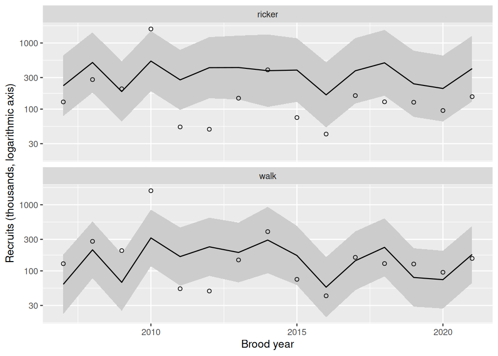

:::::::::::::::::::::::::::::::::::::::: questions

- How do I forecast with an honest interval?
- How do I know whether a model forecasts well?

::::::::::::::::::::::::::::::::::::::::::::::::::

:::::::::::::::::::::::::::::::::::::::: objectives

- Produce a median forecast with an 80% prediction interval, and explain why it is wider than the confidence interval.
- Run a hindcast for two models and a naive benchmark.
- Score forecasts by bias, mean absolute error, skill and coverage, and interpret the scores.

::::::::::::::::::::::::::::::::::::::::::::::::::


## Starting Point

This episode opens step 9 of the [Quick Start](02-quick-start.Rmd): forecasting, and testing whether the forecasts can be trusted.
It answers the Quick Start's question: which forecast would you trust?

:::::::::::::::::::::::::::::::::::::::: prereq

### Run This Only If You Are Starting Here

If you have followed along in `stellako.R`, you already have these objects: skip this chunk.
If you are starting here or have restarted R, run this chunk first.
It needs `data/sockeye.csv` and `files/cookbook.R` in your project (see [Setup](../learners/setup.md)).


``` r
library(RTMB)
library(dplyr)
library(ggplot2)
source("files/cookbook.R")        # the finished recipe box (your my-recipes.R works too)
sockeye  <- read.csv("data/sockeye.csv")
my_stock <- filter(sockeye, stock == "Stellako")
dat      <- make_dat(my_stock, S_new = 50)
ricker   <- fit_model(nll_ricker, start_ricker(dat), dat)
walk     <- fit_model(nll_walk, start_walk(dat), dat, random = "log_alpha_year")
c(ricker = all(ricker$checks), walk = all(walk$checks))
```

``` output
ricker   walk 
  TRUE   TRUE 
```

::::::::::::::::::::::::::::::::::::::::::::::::::

## Recipe: A Forecast with a Prediction Interval

**Use it when:** you forecast recruits for a given number of spawners.

**Ingredients:** a fitted model whose [data list](../learners/reference.md#glossary) has `S_new`, and whose model function reports `mu_new` with `ADREPORT()`.

We use `predict_recruits()` from [Estimates, Intervals and Derived Quantities](05-uncertainty.Rmd).
Called without `interval =`, it gives its default: a [prediction interval](../learners/reference.md#glossary), a range where next year's recruits will probably fall.
It adds the yearly noise ([sigma](../learners/reference.md#glossary)) to the uncertainty about the curve.
For the [random walk](../learners/reference.md#glossary), the uncertainty about the curve already includes one more year of drift.
This is the Quick Start's step 9, as a function.

On the [log scale](../learners/reference.md#glossary), the forecast's standard deviation (SD) combines the two parts, the curve and sigma:

$$\text{SD}_\text{forecast} = \sqrt{\text{SE}^2 + \sigma^2}$$

In words: square the [standard error](../learners/reference.md#glossary) (SE) of the curve at `S_new`, add the square of sigma, and take the square root.
In `predict_recruits()` (in `files/cookbook.R`, or your `my-recipes.R`), the line that starts `if (interval == "prediction")` does this.


``` r
predict_recruits(walk)
```

``` output
  S_new   median    lower    upper
1    50 148.0807 55.27905 396.6764
```

``` r
predict_recruits(ricker)
```

``` output
  S_new   median    lower    upper
1    50 359.0872 114.3315 1127.805
```

Each forecast is a [median](../learners/reference.md#glossary): half of the possible outcomes lie below it.
From 50 thousand spawners, the random walk forecasts a median of 148 thousand recruits, with an 80% prediction interval of 55 to 397 thousand.
The [Ricker model](../learners/reference.md#glossary) forecasts 359 thousand (114 to 1128 thousand), more than twice as many.
The Ricker uses [productivity](../learners/reference.md#glossary), recruits per spawner when spawners are few, averaged over all 74 years; the random walk uses the low productivity of recent years.

For comparison, here is the 95% [confidence interval](../learners/reference.md#glossary) for the median curve at the same spawner count:


``` r
predict_recruits(walk, interval = "confidence", level = 0.95)
```

``` output
  S_new   median    lower   upper
1    50 148.0807 80.01682 274.041
```

The 95% confidence interval (80 to 274 thousand) is narrower than the 80% prediction interval (55 to 397 thousand), although its percentage is higher.
It says how sure we are about the median curve, not where a single year will fall.

**Check it worked:** the random walk's median is 148 thousand recruits from 50 thousand spawners, as in the Quick Start. Put up a green sticky note when both forecasts print.

:::::::::::::::::::::::::::::::::::::::: callout

### Three Sources of Uncertainty

A forecast for next year is uncertain for three reasons:

- the estimate of the curve: its parameters have standard errors;
- the drift in productivity (random walk only): next year's productivity is one more step away from this year's;
- the yearly noise, sigma: single years scatter around the curve.

The prediction interval includes all three.
It does not include the chance that the model itself is wrong, which is one reason to test forecasts on past years.

::::::::::::::::::::::::::::::::::::::::::::::::::

:::::::::::::::::::::::::::::::::::::::: challenge

### Challenge 1: Which Interval? (4 minutes)

For 50 thousand Stellako spawners, the random walk gives a 95% confidence interval for the median of 80 to 274 thousand recruits, and an 80% prediction interval of 55 to 397 thousand.
Which range describes where next year's recruits will probably fall?
Then say in one sentence why the 80% interval is wider than the 95% one.

- **(a)** The 95% confidence interval, because 95 is more than 80.
- **(b)** The 80% prediction interval.
- **(c)** Both equally.
- **(d)** Neither: use the median.

:::::::::::::::::::::::: solution

The answer is (b).

- **(a)** compares the percentages but ignores what the intervals describe: the confidence interval is about the median curve, not about single years.
- **(b)** is right: next year's recruits scatter around the curve by sigma, and only the prediction interval includes that scatter.
- **(c)**: the two describe different things, so they cannot both answer the question.
- **(d)**: a median without an interval hides the uncertainty.

Why it is wider: the prediction interval adds the yearly scatter, sigma, to the uncertainty about the median curve; the confidence interval holds only the uncertainty about the curve.

:::::::::::::::::::::::::

::::::::::::::::::::::::::::::::::::::::::::::::::

:::::::::::::::::::::::::::::::::::::::: challenge

### Challenge 2: Median or Mean? (3 minutes)

`predict_recruits()` reports a median of 148 thousand.
The mean of the same forecast distribution is 199 thousand.
Which statement is right?

- **(a)** `exp()` of the log-scale forecast is the mean.
- **(b)** 148 thousand is the middle of the possible outcomes; a few very large possible outcomes pull the mean up.
- **(c)** 199 is a mistake.
- **(d)** The two should be equal.

:::::::::::::::::::::::: solution

The answer is (b).
This code computes both from the random walk's forecast on the log scale.
The mean adds half of the squared forecast SD before `exp()`.


``` r
p <- summary(walk$sdr, "report")["mu_new", ]
sd_pred <- sqrt(p[["Std. Error"]]^2 + exp(walk$opt$par[["log_sigma"]])^2)
c(median = 50 * exp(p[["Estimate"]]), mean = 50 * exp(p[["Estimate"]] + sd_pred^2 / 2))
```

``` output
  median     mean 
148.0807 199.0086 
```

- **(a)** is the misunderstanding this challenge targets: `exp()` of a log-scale forecast is the median, not the mean.
- **(b)** is right: the forecast is symmetric on the log scale, so on the natural scale it has a long upper tail, and a few very large possible outcomes pull the mean above the median.
- **(c)**: 199 is correct; it is the mean of the same distribution.
- **(d)**: median and mean are equal for a symmetric distribution, like the forecast on the log scale; recruits on the natural scale have a long upper tail, so the mean is higher.

Report the median and the interval, and say "median".
A manager asking for "the expected return" may mean the mean.

:::::::::::::::::::::::::

::::::::::::::::::::::::::::::::::::::::::::::::::

::::::::::::::::::::::::::::::::::::::::::::::::::::::::::::::::::::: instructor

Challenge 1 takes about 4 minutes and Challenge 2 about 3.
Challenge 1 targets the belief that a confidence interval says where single years fall (first met in Episode 5, where the 95% band held 24% of the Stellako points); if most learners choose (a), show that band plot again and say "the band is about the curve; single years scatter around it by sigma".
Ask two or three learners to read out their sentence on why the prediction interval is wider.
Challenge 2 targets "`exp()` of a log forecast is the mean"; if most choose (a), run the solution code live (median 148, mean 199 thousand).
If answers are spread out, go back to the two printed intervals, the 95% confidence interval and the 80% prediction interval, and compare them line by line.

::::::::::::::::::::::::::::::::::::::::::::::::::::::::::::::::::::::::::::::::

## Replaying the Past: A Hindcast

Which forecast would you trust: the random walk's 148 thousand recruits or the Ricker's 359 thousand?
We cannot wait for next year to find out.
Instead, we replay the past.
Pretend we know only [brood years](../learners/reference.md#glossary) 1948 to 2006, the years in which the parent fish spawned: fit each model to them, forecast brood year 2007, and compare with what happened.
Then repeat for every year up to 2021: 15 forecasts per model.
This test is called a [hindcast](../learners/reference.md#glossary).

{
alt="Timeline of brood years from 1948 to 2021. The first row shows a shaded training block from 1948 to 2006 followed by one forecast year, 2007. The next row trains to 2007 and forecasts 2008, and so on, until the last row trains to 2020 and forecasts 2021. Later years in each row are not used."
}

Each forecast uses only the years before it, so it is a fair test: the model never saw the year it forecasts.

## Recipe: Test Forecasts on Past Years

**Use it when:** you need evidence that a model forecasts well.

**Ingredients:** a fitted model (it carries its own recipe: the model function, the starting values and `random`), the stock's data frame, and the first test year.

Choose the first test year before you see any scores, as the timing of the [North Pacific Gyre Oscillation (NPGO)](../learners/reference.md#glossary) index was chosen in [Comparing Models with AIC](09-model-selection.Rmd).
Here 2007 leaves 59 years to fit and 15 to test.
The recipe works for models whose data list comes from `make_dat()` alone: the Ricker, [Beverton-Holt](../learners/reference.md#glossary) and random-walk models.
A model with a covariate, such as Ricker + NPGO, would also need the covariate in every training data list; this lesson does not hindcast it.


``` r
hindcast <- function(m, df, first_year) {
  out <- NULL
  for (yr in df$brood_year[df$brood_year >= first_year]) {     # observed years only
    train <- filter(df, brood_year < yr)                         # what we knew then
    test  <- filter(df, brood_year == yr)                        # what happened next
    m_yr  <- fit_model(m$nll, m$par, make_dat(train, S_new = test$spawners), m$random)
    out   <- rbind(out, data.frame(brood_year = yr, observed = test$recruits,
                                   predict_recruits(m_yr), fit_ok = all(m_yr$checks)))
  }
  out
}
```

Read it line by line:

- `out` starts empty, and each pass of the loop adds one row to it with `rbind()`, as in `self_test()` in [Checking a Model with Simulation](08-simulation.Rmd);
- the loop runs over the brood years in the data from `first_year` on: observed years only, so it also runs on stocks with missing years;
- `train` is what we knew then: every brood year before the test year;
- `test` is what happened next: the test year's spawners and recruits;
- `fit_model()` refits the same model, with the same starting values (`m$par`) and the same `random`, to the training years only, with `S_new` set to the test year's spawners;
- `predict_recruits()` gives the forecast, and `data.frame()` puts its four columns (`S_new`, `median`, `lower` and `upper`) between `observed` and `fit_ok`;
- `fit_ok` records whether the refit passed the [four checks](../learners/reference.md#glossary).

Reusing `m$par` works for the random walk because its starting list already has a value for every year, plus one.
A shorter training period leaves the later values with no data; RTMB averages over them, as it does for every random effect, and they do not change the forecast.

Try it on the last three years first; it takes a fraction of a second.
Before you run it, write down how many rows it will return, and which brood years the 2020 forecast is fitted to.


``` r
hindcast(walk, my_stock, first_year = 2019)
```

``` output
  brood_year observed  S_new    median    lower    upper fit_ok
1       2019  126.960 26.723  79.47713 28.75086 219.7017   TRUE
2       2020   95.206 22.136  73.66408 26.94306 201.4024   TRUE
3       2021  154.205 62.122 177.17753 65.74350 477.4902   TRUE
```

Each row is one test year: what happened (`observed` recruits), the spawners (`S_new`) and the forecast (`median`, `lower` and `upper`), all in thousands of fish.
The 2020 forecast was fitted to brood years 1948 to 2019.

**Check it worked:** three rows, for 2019 to 2021, each with `fit_ok` TRUE. Put up a green sticky note when you have them.

## Recipe: A Naive Benchmark

**Use it when:** you score any forecasting model.

**Ingredients:** the stock's data frame and the first test year.

A model earns its place only if it forecasts better than a rule with no model at all.
Our [benchmark](../learners/reference.md#glossary), a naive forecast, is: for each test year, recruits per spawner as in the four previous brood years, times the spawners.
Its 80% interval comes from how wrong this rule was in earlier years.

You do not need to type it: `naive_forecast()` is in [the finished recipe box (cookbook.R)](files/cookbook.R), which the Starting Point loaded.
If you loaded your own `my-recipes.R` instead, run `source("files/cookbook.R")` now: `naive_forecast()` is not in your box yet.
Read it:


``` r
naive_forecast <- function(df, first_year) {
  df <- mutate(df, logRS = log(recruits / spawners))
  df$recent <- sapply(df$brood_year, function(yr) mean(df$logRS[df$brood_year %in% (yr - 4):(yr - 1)]))
  out <- NULL
  for (yr in df$brood_year[df$brood_year >= first_year]) {
    past   <- filter(df, brood_year < yr, !is.na(recent))
    sd_err <- sd(past$logRS - past$recent)                     # how wrong the rule was before
    test   <- filter(df, brood_year == yr)
    out <- rbind(out, data.frame(brood_year = yr, observed = test$recruits, S_new = test$spawners,
                                 median = test$spawners * exp(test$recent),
                                 lower  = test$spawners * exp(test$recent - qnorm(0.9) * sd_err),
                                 upper  = test$spawners * exp(test$recent + qnorm(0.9) * sd_err),
                                 fit_ok = TRUE))
  }
  out
}
```

- `recent` is the average log(R/S) of the four brood years before each year;
- the first brood year has no earlier years, so its `recent` is missing (`NaN`), and `past` leaves it out;
- `sd_err` is the SD of the rule's errors in the years before the test year, on the log scale;
- the forecast is the test year's spawners times exp(`recent`), and the 80% interval goes `qnorm(0.9)` (1.28) times `sd_err` either side of it on the log scale;
- `fit_ok` is always `TRUE`, because nothing is fitted: the column is there so that the table stacks with the output of `hindcast()`, and `all(hc$fit_ok)` still works.


``` r
naive_forecast(my_stock, first_year = 2019)
```

``` output
  brood_year observed  S_new    median    lower    upper fit_ok
1       2019  126.960 26.723  55.11715 18.12830 167.5777   TRUE
2       2020   95.206 22.136  60.27146 19.80968 183.3775   TRUE
3       2021  154.205 62.122 190.76561 63.01771 577.4807   TRUE
```

**Check it worked:** it returns the same columns as `hindcast()`, so the two can be stacked in one table. Put up a green sticky note when the three rows print.

## Recipe: Score the Forecasts

**Use it when:** you have hindcasts for several models and a benchmark.

**Ingredients:** one data frame of hindcasts with a `model` column, in which the benchmark is called `naive`.

`score_forecasts()` turns the hindcast table into four numbers per model.
Each forecast's error is log(forecast / observed): above 0 means the forecast was too high, and an error of 0.69 means it was twice what happened.


``` r
score_forecasts <- function(hc) {
  hc %>%
    mutate(error = log(median / observed)) %>%                 # above 0: forecast too high
    group_by(model) %>%
    summarise(n = n(), bias = mean(error), MAE = mean(abs(error)),
              coverage80 = mean(observed >= lower & observed <= upper), .groups = "drop") %>%
    mutate(skill = MAE / MAE[model == "naive"])                # below 1: beats the benchmark
}
```

Now run the hindcast from 2007 for both models and the benchmark, and score it.
The 30 refits take about a second.


``` r
hc <- bind_rows(ricker = hindcast(ricker, my_stock, first_year = 2007),
                walk   = hindcast(walk,   my_stock, first_year = 2007),
                naive  = naive_forecast(my_stock, first_year = 2007),
                .id = "model")
all(hc$fit_ok)
```

``` output
[1] TRUE
```

``` r
score_forecasts(hc)
```

``` output
# A tibble: 3 × 6
  model      n     bias   MAE coverage80 skill
  <chr>  <int>    <dbl> <dbl>      <dbl> <dbl>
1 naive     15 -0.126   0.811      0.733 1    
2 ricker    15  0.827   0.992      0.6   1.22 
3 walk      15 -0.00960 0.644      0.733 0.794
```

The four scores, one line each:

- `bias`: the [bias](../learners/reference.md#glossary), the average of log(forecast / observed); above 0 means the forecasts were too high;
- `MAE`, the [mean absolute error](../learners/reference.md#glossary): the typical size of an error, on the log scale;
- `coverage80`: the [coverage](../learners/reference.md#glossary), the share of observations inside the 80% prediction interval; we want 0.80;
- `skill`: the [forecast skill](../learners/reference.md#glossary), the MAE divided by the benchmark's MAE; below 1 beats the benchmark.

The same ratio is also called the relative MAE.
Some reports use 1 minus it as a skill score, where above 0 beats the benchmark, so check which one a report uses before you compare.

**Check it worked:** every refit passed (`all(hc$fit_ok)` is TRUE), and the random walk's skill is about 0.79. Put up a green sticky note when your score table prints.

:::::::::::::::::::::::::::::::::::::::: caution

### Common Problems: Test Forecasts on Past Years

Table: Problems when testing forecasts on past years, with their likely causes and fixes.

| What you see | Likely cause | Fix |
|:---|:---|:---|
| `score_forecasts()` stops with `` `skill` must be size 3 or 1, not 0 `` (or another size) | no rows are called `naive` | name the benchmark `naive` in `bind_rows()` |
| `hindcast()` stops with `object 'npgo' not found` or `non-numeric argument to binary operator` | a model with a covariate: `make_dat()` does not put the covariate in the training data | hindcast only models whose data list comes from `make_dat()` alone |
| `all(hc$fit_ok)` is FALSE | some refits failed one of the four checks | list them with `filter(hc, !fit_ok)`, report them, and see [Troubleshooting](../learners/troubleshooting.md) |

::::::::::::::::::::::::::::::::::::::::::::::::::

::::::::::::::::::::::::::::::::::::::::::::::::::::::::::::::::::::: instructor

The hindcast takes under 1 second per stock, so it is safe to run live.
Ask for sticky notes when the score table prints, and read the four columns aloud with the class before moving on.
If `score_forecasts()` stops with "`skill` must be size 3 or 1, not 0", the table has no rows called `naive`: check the names in `bind_rows()`.

::::::::::::::::::::::::::::::::::::::::::::::::::::::::::::::::::::::::::::::::

:::::::::::::::::::::::::::::::::::::::: challenge

### Challenge 3: Read a Score Row (3 minutes)

Another model's hindcast row reads: bias 0.40, MAE 0.70, coverage80 0.93, skill 0.86.
Which reading is right?

- **(a)** It beat the benchmark, but its forecasts were too high by a factor of about exp(0.40) = 1.5 on average.
- **(b)** It did worse than the benchmark, because its skill is above 0.
- **(c)** Its intervals were too narrow, because 0.93 is far from 0.80.
- **(d)** It shows no sign of bias, because its MAE is larger than its bias.

:::::::::::::::::::::::: solution

The answer is (a).

- **(a)** is right: a skill below 1 means its errors were smaller than the benchmark's in the test years, and a bias above 0 means its forecasts were too high on average.
- **(b)** compares skill with 0, but this skill is a ratio: compare it with 1, the benchmark's own skill.
- **(c)** reads coverage the wrong way round: 0.93 means its intervals caught more outcomes than the 80% promised, so if anything they were too wide.
- **(d)** mixes up the two scores: the MAE averages the size of the errors, so it is never smaller than the bias, and comparing them says nothing; a bias of 0.40 means the forecasts were too high on average.

:::::::::::::::::::::::::

::::::::::::::::::::::::::::::::::::::::::::::::::

::::::::::::::::::::::::::::::::::::::::::::::::::::::::::::::::::::: instructor

Challenge 3 takes about 3 minutes.
If most learners choose (b), point to the score table: the benchmark's own skill is exactly 1, and every skill is compared with it.
If most choose (c), say that coverage above 0.80 means more outcomes inside the intervals than promised.
If answers are spread out, go back to the four definitions and read the random walk's row of the Stellako table together.

::::::::::::::::::::::::::::::::::::::::::::::::::::::::::::::::::::::::::::::::

## Reading the Scores

Plot the two models' forecasts against what happened:


``` r
hc %>%
  filter(model != "naive") %>%
  ggplot(aes(x = brood_year, y = median)) +
  geom_ribbon(aes(ymin = lower, ymax = upper), fill = "grey80") +
  geom_line() +
  geom_point(aes(y = observed), shape = 1) +
  facet_wrap(~ model, ncol = 1) +
  scale_y_log10() +
  labs(x = "Brood year", y = "Recruits (thousands, logarithmic axis)")
```

<div class="figure" style="text-align: center">

<p class="caption">Stellako hindcast, brood years 2007 to 2021. Line: median forecast; grey band: 80% prediction interval; open circles: what happened.</p>
</div>

The Ricker's forecasts sit above most of what happened, and the random walk's run through the middle; in both panels, several years fall outside the grey band.

The random walk:

- beat the benchmark in these 15 years (skill 0.79);
- shows no sign of bias (bias -0.01).

The Ricker:

- did worse than the benchmark (skill 1.22);
- was too high by a factor of exp(0.83) = 2.3 on average.

Count how often each method forecast too high:


``` r
hc %>%
  group_by(model) %>%
  summarise(too_high = sum(median > observed), n = n())
```

``` output
# A tibble: 3 × 3
  model  too_high     n
  <chr>     <int> <int>
1 naive         7    15
2 ricker       12    15
3 walk          7    15
```

The Ricker was too high in 12 of 15 years: it still expects the productivity of the past.
The random walk and the benchmark were too high in 7 of 15: about as often too high as too low.

Both models' intervals caught fewer outcomes than promised: 73% (random walk, 11 of 15) and 60% (Ricker, 9 of 15), where 80% (12 of 15) was promised.
The benchmark's intervals also caught 73%.

Each score is an average of only 15 forecasts, so it would change if a few years had gone differently.
One year more or less moves coverage by about 0.07.
How often would honest 80% intervals catch 11 or fewer of 15 outcomes, by chance alone?
`pbinom()` gives that chance, when each of the 15 outcomes has an 80% chance of falling inside:


``` r
pbinom(11, size = 15, prob = 0.8)       # 11 or fewer of 15 inside
```

``` output
[1] 0.3518379
```

About one time in three.
So the random walk's 0.73 is a warning sign, not proof that its intervals are too narrow; the Ricker's 0.60 is a clearer warning.
In the same way, treat differences of a few hundredths in skill as ties.
The Ricker's bias of +0.83, too high in 12 of 15 years, is large enough to act on.

Here forecast skill agrees with the Akaike information criterion ([AIC](../learners/reference.md#glossary)) from [Comparing Models with AIC](09-model-selection.Rmd): both prefer the random walk.
In Upper Pitt River (Challenge 4), the model with the lower AIC does not have the smaller forecast errors.

:::::::::::::::::::::::::::::::::::::::: caution

### How Honest Is This Hindcast?

When a brood year is forecast in practice, the recruits of the brood year before it are not all counted yet: the oldest of them return in the same calendar year as the fish being forecast.
Real forecasts, made before each fishing season, predict the fish returning in one calendar year, age by age, not one brood year.
This hindcast therefore makes every method, the benchmark included, look slightly better than it would in real use.
In any field, check that each forecast uses only data that would really have been available at the time.

::::::::::::::::::::::::::::::::::::::::::::::::::

:::::::::::::::::::::::::::::::::::::::: spoiler

### Going Further: A Log Score (optional)

Bias, MAE and coverage each judge one thing.
A log score judges the median and the interval together.
For each test year, it asks how probable the observed recruits were under the forecast's distribution on the log scale, and takes the log.
It is the surprise score turned around: a forecast that was close, and honest about its uncertainty, was not surprised.
The first line recovers each forecast's SD on the log scale from the width of its 80% interval.


``` r
hc %>%
  mutate(sd = (log(upper) - log(lower)) / (2 * qnorm(0.9)),
         log_score = dnorm(log(observed), log(median), sd, log = TRUE)) %>%
  group_by(model) %>%
  summarise(log_score = mean(log_score))
```

``` output
# A tibble: 3 × 2
  model  log_score
  <chr>      <dbl>
1 naive      -1.44
2 ricker     -1.67
3 walk       -1.22
```

Higher is better: the random walk scores best (-1.22), then the benchmark (-1.44), then the Ricker (-1.67).
The log score rewards forecasts that are close and honest about their uncertainty at the same time.

::::::::::::::::::::::::::::::::::::::::::::::::::

:::::::::::::::::::::::::::::::::::::::: challenge

### Challenge 4: Your Turn: Upper Pitt River, Rows 8 and 9 (15 minutes)

For Upper Pitt River, run the hindcast from 2007 for the Ricker, the random walk and the benchmark, and score it.
Then forecast from the random walk, with `S_new` set to the average spawners of the last four brood years.
Add the code to `upper-pitt-river.R` and write rows 8 and 9 of your report card under it:

- row 8: the bias, MAE, skill and 80% coverage of each model and the benchmark, in one or two sentences;
- row 9: the median and 80% prediction interval from the random walk, with units and the word "median".

Compare row 8 with row 7 (AIC): do they agree?

:::::::::::::::::::::::: hint

`pitt`, `dat_pitt`, `ricker_pitt` and `walk_pitt` are in `upper-pitt-river.R`; run it from the top if they are not in your workspace.
Then copy the `hc <- bind_rows(...)` chunk that ran the hindcast from 2007 and change the names: `pitt` for `my_stock`, `ricker_pitt` and `walk_pitt` for `ricker` and `walk`, and `hc_pitt` for `hc`.
If row 7 is not in your report card, run `aic_table(list(ricker = ricker_pitt, walk = walk_pitt))`.
Row 9 can follow this frame: "From ___ thousand spawners, the random walk forecasts a median of ___ thousand recruits (80% prediction interval ___ to ___ thousand)."

:::::::::::::::::::::::::

:::::::::::::::::::::::: solution


``` r
pitt        <- filter(sockeye, stock == "Upper Pitt River")
dat_pitt    <- make_dat(pitt, S_new = mean(tail(pitt$spawners, 4)))
ricker_pitt <- fit_model(nll_ricker, start_ricker(dat_pitt), dat_pitt)
walk_pitt   <- fit_model(nll_walk, start_walk(dat_pitt), dat_pitt, random = "log_alpha_year")
hc_pitt <- bind_rows(ricker = hindcast(ricker_pitt, pitt, first_year = 2007),
                     walk   = hindcast(walk_pitt,   pitt, first_year = 2007),
                     naive  = naive_forecast(pitt, first_year = 2007),
                     .id = "model")
all(hc_pitt$fit_ok)
```

``` output
[1] TRUE
```

``` r
score_forecasts(hc_pitt)
```

``` output
# A tibble: 3 × 6
  model      n     bias   MAE coverage80 skill
  <chr>  <int>    <dbl> <dbl>      <dbl> <dbl>
1 naive     15 -0.169   1.13       0.4   1    
2 ricker    15  0.739   0.880      0.667 0.782
3 walk      15  0.00247 0.919      0.6   0.817
```

``` r
predict_recruits(walk_pitt)
```

``` output
    S_new   median    lower    upper
1 5.30975 12.43981 4.392489 35.23036
```

``` r
aic_table(list(ricker = ricker_pitt, walk = walk_pitt))    # row 7, for the comparison
```

``` output
   model k      AIC checks_ok     dAIC
2   walk 4 185.6467      TRUE  0.00000
1 ricker 3 197.4595      TRUE 11.81284
```

Row 8: "Both models beat the recent-average benchmark in these 15 years (skill 0.78 for the Ricker and 0.82 for the random walk). Their errors are about the same size (MAE 0.88 and 0.92), but the Ricker was too high by a factor of exp(0.74) = 2.1 on average, while the random walk shows no sign of bias (0.002). All intervals caught fewer outcomes than the 80% promised (coverage 0.40 to 0.67); the benchmark's 0.40 is far too low."

Row 9: "From 5.3 thousand spawners, the random walk forecasts a median of 12 thousand recruits (80% prediction interval 4.4 to 35 thousand)."

In `upper-pitt-river.R`, add the lines from `hc_pitt <- bind_rows(` on, then the two row comments.
Your script now runs Upper Pitt River from the data to a tested forecast, which is what the capstone asks you to do for a new stock.

Rows 7 and 8 agree only in part.
AIC (row 7) prefers the random walk by 11.8, but the Ricker's forecast errors were slightly smaller (mean absolute error 0.88 against 0.92): a lower AIC did not bring smaller forecast errors.
In 15 forecasts that difference is a tie, while the Ricker's bias (+0.74) is a clear fault.
AIC measures how well a model describes the years it was fitted to; the hindcast measures how well it forecast years it had not seen.
A defensible choice is the random walk, because it shows no sign of bias and passes the residual checks, with both results reported.

:::::::::::::::::::::::::

::::::::::::::::::::::::::::::::::::::::::::::::::

::::::::::::::::::::::::::::::::::::::::::::::::::::::::::::::::::::: instructor

Challenge 4 is the longest coding task before the capstone (15 minutes), so have helpers circulate.
The hindcast and scoring code is in the handout; learners change the stock and the object names.
Learners who finish early can try the optional Challenge 6 at the end of the episode.
Watch for the belief that a lower AIC means better forecasts: Upper Pitt River shows a lower AIC without smaller forecast errors, and the capstone share-out returns to it.

::::::::::::::::::::::::::::::::::::::::::::::::::::::::::::::::::::::::::::::::

:::::::::::::::::::::::::::::::::::::::: challenge

### Challenge 5: What Do You Tell a Manager? (5 minutes)

Stellako's random walk caught 73% of past outcomes (11 of 15) in its 80% intervals; the Ricker caught 60% (9 of 15).
What should a manager be told along with the forecast?
Discuss in pairs.

:::::::::::::::::::::::: solution

Points the instructor should hear:

- the intervals caught fewer outcomes than promised, so the real uncertainty is probably larger than they suggest; say how many years the coverage rests on;
- report the coverage next to the forecast, so readers can judge how much wider the real uncertainty may be;
- a model that expects occasional extreme years (heavier tails; see [Going Further](../learners/going-further.md)) may give more honest intervals;
- do not drop the interval because it is inconvenient.

:::::::::::::::::::::::::

::::::::::::::::::::::::::::::::::::::::::::::::::

:::::::::::::::::::::::::::::::::::::::: callout

### Intervals That May Be Too Narrow

Coverage below 0.80 warns that the intervals may be too narrow on new years.
With about 15 forecasts it is a rough measure: coverage well below 0.80, or below 0.80 in stock after stock, is stronger evidence.
Report the coverage, and the number of forecasts behind it, next to the forecast.

::::::::::::::::::::::::::::::::::::::::::::::::::

:::::::::::::::::::::::::::::::::::::::: challenge

### Challenge 6 (Optional): A Second Benchmark (not timed)

Another benchmark: "recruits per spawner as last year".
Copy `naive_forecast()` from [the finished recipe box (cookbook.R)](files/cookbook.R), call the copy `last_year_forecast()`, and change `(yr - 4):(yr - 1)` to `(yr - 1)`.
Then copy the `hc <- bind_rows(...)` chunk that ran the hindcast from 2007, call the result `hc_4`, and add the line `last_year = last_year_forecast(my_stock, first_year = 2007),` before `.id = "model"`.
Score all four.
Does the random walk beat the new benchmark?

:::::::::::::::::::::::: hint

Keep the brackets around `yr - 1`.
R works out `%in%` before `-`, so `df$brood_year %in% yr - 1` means `(df$brood_year %in% yr) - 1`: it gives no error, but it averages the wrong years.

:::::::::::::::::::::::::

:::::::::::::::::::::::: solution


``` r
last_year_forecast <- function(df, first_year) {
  df <- mutate(df, logRS = log(recruits / spawners))
  df$recent <- sapply(df$brood_year, function(yr) mean(df$logRS[df$brood_year %in% (yr - 1)]))
  out <- NULL
  for (yr in df$brood_year[df$brood_year >= first_year]) {
    past   <- filter(df, brood_year < yr, !is.na(recent))
    sd_err <- sd(past$logRS - past$recent)                     # how wrong the rule was before
    test   <- filter(df, brood_year == yr)
    out <- rbind(out, data.frame(brood_year = yr, observed = test$recruits, S_new = test$spawners,
                                 median = test$spawners * exp(test$recent),
                                 lower  = test$spawners * exp(test$recent - qnorm(0.9) * sd_err),
                                 upper  = test$spawners * exp(test$recent + qnorm(0.9) * sd_err),
                                 fit_ok = TRUE))
  }
  out
}
hc_4 <- bind_rows(ricker    = hindcast(ricker, my_stock, first_year = 2007),
                  walk      = hindcast(walk,   my_stock, first_year = 2007),
                  naive     = naive_forecast(my_stock, first_year = 2007),
                  last_year = last_year_forecast(my_stock, first_year = 2007),
                  .id = "model")
score_forecasts(hc_4)
```

``` output
# A tibble: 4 × 6
  model         n     bias   MAE coverage80 skill
  <chr>     <int>    <dbl> <dbl>      <dbl> <dbl>
1 last_year    15  0.0602  0.652      0.933 0.805
2 naive        15 -0.126   0.811      0.733 1    
3 ricker       15  0.827   0.992      0.6   1.22 
4 walk         15 -0.00960 0.644      0.733 0.794
```

The other three rows are as before; skill is still measured against `naive`.
The random walk (skill 0.794) and "same as last year" (0.805) tie: in 15 forecasts, a difference this small could go either way.
The last-year rule shows no sign of bias (0.06), and its intervals caught 93% of what happened (14 of 15), more than the 80% promised.
Forecast skill is modest, and a rule with no model can be a strong benchmark: always include one.

:::::::::::::::::::::::::

::::::::::::::::::::::::::::::::::::::::::::::::::

:::::::::::::::::::::::::::::::::::::::: callout

### Add to Your Recipe Box

Copy these functions into your `my-recipes.R`: `hindcast()`, `naive_forecast()` (copy it from `cookbook.R`) and `score_forecasts()`.
The finished box is [cookbook.R](files/cookbook.R).

::::::::::::::::::::::::::::::::::::::::::::::::::

:::::::::::::::::::::::::::::::::::::::: callout

### In Your Field

Replay the past before you trust the future.
Any time-series model can be refitted to earlier years and scored on the next one, against a benchmark such as the recent average.

::::::::::::::::::::::::::::::::::::::::::::::::::

:::::::::::::::::::::::::::::::::::::::: keypoints

- `predict_recruits()` gives a median with an 80% prediction interval that includes uncertainty about the curve, drift (for the random walk) and the yearly noise, so it is wider than the confidence interval for the median curve.
- A hindcast refits the model to past years only and forecasts the next year, again and again.
- Score forecasts against a naive benchmark: skill below 1 beats it. Also report bias and interval coverage.
- AIC and forecast skill answer different questions and can disagree; report both.

::::::::::::::::::::::::::::::::::::::::::::::::::
