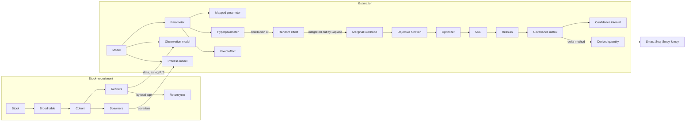

# Glossary: salmon population modelling

This is a starting point for a ubiquitous language (a controlled vocabulary together with a domain model) for building salmon population models. It starts with the terms that the RTMB workshop (16–17 November 2026) uses and that people often confuse. It is a seed for the CTC and SCA vocabulary that OQ-2026-10-16-03 (*Domain-Driven Design and Agency Data Contract*, ctc-chinook-wiki) proposes. It is not a PSC or CTC standard.

Status: draft, staged in the workshop repository. This is the only glossary file. See "Next steps" for where it goes after the workshop.

## Contents

-   [Contexts](#contexts)
    -   [Relationships between contexts](#relationships-between-contexts)
-   [Estimation](#estimation)
    -   [Model structure](#model-structure)
    -   [Scales](#scales)
    -   [Likelihood](#likelihood)
    -   [Optimisation](#optimisation)
    -   [Inference](#inference)
    -   [Model checking](#model-checking)
    -   [Relationships in estimation](#relationships-in-estimation)
    -   [Flagged ambiguities](#flagged-ambiguities)
-   [Stock–recruitment](#stockrecruitment)
    -   [Fish and years](#fish-and-years)
    -   [Counts](#counts)
    -   [Ricker model](#ricker-model)
    -   [Forecasting](#forecasting)
    -   [Relationships in stock–recruitment](#relationships-in-stockrecruitment)
-   [Domain model](#domain-model)
-   [Bridge to SCA and CTC](#bridge-to-sca-and-ctc)
-   [Next SCA terms](#next-sca-terms)
-   [During the workshop](#during-the-workshop)
-   [Next steps (after the workshop)](#next-steps-after-the-workshop)

## Contexts

The glossary has two contexts now and a third that is not written yet.

-   [Estimation](#estimation): likelihood, parameters, random effects, optimisation, uncertainty and model checking. These terms are the same for every model.
-   [Stock–recruitment](#stockrecruitment): spawners, recruits, brood years and the Ricker model, as the workshop uses them.
-   *SCA and CTC* (not written yet): statistical catch-at-age, exploitation-rate analysis and CTC reporting. The [bridge](#bridge-to-sca-and-ctc) lists where its words collide with the two contexts above.

All entries are drafts written before the RTMB workshop (16–17 November 2026). When the workshop confirms or changes an entry, it gets a `_Workshop_` line.

### Relationships between contexts

-   **Stock–recruitment → Estimation**: a stock–recruitment model is one kind of model. Its parameters (log productivity, density dependence) are fixed effects or random effects. Smax, Seq, Smsy and Umsy are derived quantities.
-   **SCA → Estimation**: an SCA model is also a model in the estimation sense. It uses the same words for likelihood, random effect, penalised deviation and confidence interval.
-   **SCA ↔ Stock–recruitment**: both count fish by cohort, but they use "recruitment", "stock" and "age" in different ways (see the bridge).

## Estimation

The language of likelihood-based estimation: how a model, its parameters, the data and the optimizer relate, and how uncertainty is reported. It is the same for a Ricker fit, a hierarchical model or a statistical catch-at-age (SCA) model. RTMB is one tool that does this work.

### Model structure

**Model**:
A set of assumptions that gives a probability distribution for the data, for each set of parameter values.
_Avoid_: "the code", "the fit", "the script"

**Process model**:
The part of a model that describes how the true, unobserved state changes (for example, recruitment from spawners, or productivity from year to year).
_Avoid_: "biological model" when the observation model is also meant

**Observation model**:
The part of a model that describes how the data relate to the true state, including measurement error.
_Avoid_: "error model", "likelihood" (the likelihood uses both parts)

**Process error**:
Variation in the true state that the process model does not explain.
_Avoid_: "noise", "residual error" when observation error is also meant

**Observation error**:
The difference between a measurement and the true value it measures.
_Avoid_: "noise", "sampling error" when it includes more than sampling

**Parameter**:
An unknown, fixed quantity in a model whose value is estimated from the data.
_Avoid_: "variable", "coefficient" (use coefficient only for a parameter that multiplies a covariate)

**Fixed effect**:
A parameter estimated by maximising the marginal likelihood directly.
_Avoid_: "fixed parameter" (that is a mapped parameter)

**Random effect**:
An unobserved quantity that has its own probability distribution in the model and that is integrated out of the likelihood.
_Avoid_: "random parameter", "deviation" when the quantity is not integrated out (see penalised deviation)
_Workshop_: Paul (Day 1, 09:47, module 2): a group-level random intercept. Observations in the same group are not independent, because they share the group's effect. Observations in different groups are independent. The model needs one integral for each group (7 groups give 7 one-dimensional integrals), and the likelihood is their product.

_Workshop_: Paul (Day 2, 09:11–09:20, module 5): each stock's productivity α_s = α₀ + u_s, with u_s ~ N(0, σ_re). That is one draw for each stock from one shared distribution. The data are conditional on the realised u: log(R/S) | u ~ N(μ + u, σ_obs). The joint density is that conditional density times the density of u, and that is the hierarchical model. σ_re is shared across stocks because it describes the spread **between** stocks. One stock gives only one draw, which cannot estimate a variance. Sharing is what lets the stocks borrow strength, because each u_s is shrunk toward α₀. In chisca, `log_sig_p_recs` is one SD for each dgroup, which is possible because each stock contributes many yearly deviations.

**Partial pooling (shrinkage)**:
Estimating a quantity for each group as a compromise between that group's own data and the shared mean. A group with weak data moves more toward the mean. It is what a random effect with one shared variance does. The two extremes are no pooling (a separate fixed effect for each group) and complete pooling (one value for all groups).
_Avoid_: "borrowing strength" without saying what is shared; "smoothing" when groups, not time, are pooled
_Workshop_: Day 2 (09:20, module 5): yesterday's model, with a fixed α for each stock, was no pooling, and its flat likelihood gave unreliable α for stocks with weak data. Pooling all stock-years under one α would be complete pooling, and it would also be pseudoreplication for α₀, because the stock-years are not independent replicates. The random effect is in between.

**Mixture distribution**:
A distribution made by adding together several distributions, each weighted by the probability of its group. It is the marginal distribution when the group is a discrete random quantity.
_Avoid_: "non-normal data" when a missing group is the cause
_Workshop_: Paul (Day 1, 09:45, module 2): human heights are a mixture of two normal distributions, one for each sex. This is why you test normality on the residuals, not on the raw data.
_Workshop_: Paul (Day 1, 13:35, module 3): some marginal likelihoods have an exact integral. A linear mixed model is one example, and a Poisson with a gamma random effect gives the negative binomial. For others, the computer must approximate the integral. Module 5 uses Laplace to recover the negative binomial.

**Centred and non-centred parameterisation**:
Three ways to write the same random effect: (1) centred, α_s ~ N(α₀, σ); (2) a deviation with mean 0, ε_s ~ N(0, σ), and α_s = α₀ + ε_s; (3) non-centred, z_s ~ N(0, 1), and α_s = α₀ + σ·z_s. They are the same model. Only (3) puts σ outside the density, and only (3) uses a true standard normal. With Laplace, the marginal likelihood is the same for all three. The choice changes how easy the inner and outer problems are to solve.
_Avoid_: calling option 2 "standard normal"
_Workshop_: Paul (Day 2, 09:04–09:05, module 5, "Ways to Code Random Effects") started with a stock-level random productivity around a global α₀. He first called it non-centred, then corrected himself to "centred".
_Workshop_: Paul (Day 2, 09:05–09:10): option 3 is "a shift and a scale", and Stan or `tmbstan` prefer it for Hamiltonian Monte Carlo (HMC), which uses gradients to sample the posterior. Var(σZ) = σ² Var(Z) = σ². Paul's own mental model is option 2, "fixed effects plus white noise".

**Penalised deviation**:
An unobserved quantity that is estimated as an ordinary parameter, with its distribution added to the objective as a penalty. The result is the joint likelihood, not the marginal likelihood.
_Avoid_: "random effect"

**Hyperparameter**:
A parameter of the distribution of the random effects: its mean, its standard deviation or its autocorrelation. Hyperparameters are fixed effects, estimated by maximising the marginal likelihood, while the random effects they describe are integrated out.
_Avoid_: "hyper parameter" (two words); "variance component" when it includes a mean or a correlation
_Workshop_: Paul (Day 2, 09:11–09:13, module 5, "Coding in RTMB"): in the stock-level productivity model, the hyperparameters are α₀, "the global mean or shared intercept", and the random effects' standard deviation (log σ_re). The random effects themselves are passed to `MakeADFun` in the parameter list "even though it's not a parameter, it's a random variable". `random =` is what makes RTMB integrate them out. In chisca, `log_sig_p_recs` and `log_mu_p_recs` are hyperparameters of `log_epsilon_p_recs`.

**Mapped parameter**:
A parameter that is held at a set value, or made to share one value with other parameters, and is not estimated by itself.
_Avoid_: "fixed parameter", "fixed effect", "turned-off parameter"
_Workshop_: Paul (Day 1, 16:17–16:18, worked example): `map = list(b = factor(rep(NA, length(b))))` holds every spline coefficient at its starting value (0), which turns the term off without deleting code. The slides on `map` come later.
_Workshop_: Paul (Day 2, 10:50–10:53, module 5): to turn the AR(1) into iid year effects without changing code, map logit φ to a factor of NA at start value 0 (so φ = 2·plogis(0) − 1 = 0). A factor with NA fixes a parameter; shared levels (for example `factor(rep(1, n))`) make several parameters estimate one value. With φ = 0 the time effects follow the same pattern, but σ_time gets bigger ("it can jump quickly"), and the fit is less useful for prediction: "an unstructured random effect" gives "a big funnel" for next year. Claude's note: his next idea, mapping logit φ to a very large value so that φ → 1 (a random walk), breaks the stationary start σ²/(1 − φ²), which becomes infinite. A random walk needs its own first-year prior, or a fixed first value.

**Derived quantity**:
A quantity calculated from the parameters after the model is fitted (for example Smax or Smsy). Its uncertainty comes from the delta method or from simulation.
_Avoid_: "parameter", "output"
_Workshop_: Paul (Day 1, 11:42, live code): calculate Smax (and σ on its natural scale) inside the objective function with `REPORT()`, then read it with `obj$report()`. `ADREPORT()` adds a standard error and comes later (module 4).

**Covariate**:
An observed quantity that explains part of the variation in the data (for example, the number of spawners).
_Avoid_: "predictor", "independent variable", "driver"

**Linear predictor**:
The sum of the covariates multiplied by their coefficients for one observation, before a link function is applied.
_Avoid_: calling the coefficients "the linear predictors"

**Sparse matrix**:
A matrix stored by its non-zero values and their positions only. Calculations skip the zeros, so the result is the same but faster and smaller.
_Avoid_: "compressed matrix" without the storage format
_Workshop_: Paul (Day 1, 11:36–11:37): a factor design matrix is mostly zeros, and RTMB "loves sparsity". Sparsity matters most in the Hessian, where inverses and matrix products cost much more. Claude's note: R's default sparse class (`dgCMatrix` in the Matrix package) is column-compressed. It stores the row positions for each column.

**Design matrix**:
The matrix that holds one row for each observation and one column for each coefficient. The linear predictor is the design matrix times the coefficient vector.
_Workshop_: Paul (Day 1, 11:23–11:28, live code): use one design matrix for α and a separate one for β, so that "one objective function instead of ten" covers Ricker, a year effect on α and Larkin lags. The β matrix must have no intercept, because α is the intercept. If you add other terms, the "β is positive" transformation no longer applies directly.

**Treatment contrast**:
The default way R codes a factor in a design matrix with an intercept. The intercept is the value for the first level, and each other coefficient is the *difference* from that level.
_Avoid_: reading those coefficients as the values for each level

**Cell-means coding**:
Coding a factor without an intercept (`~ 0 + factor`), so that each coefficient is the value for its own level. The workshop uses it for α: one log productivity for each stock.
_Avoid_: "no-intercept model" when there is still one intercept for each level
_Workshop_: Paul (Day 1, 11:31–11:33) drew both codings at the whiteboard: with an intercept, β₁ is "the amount that I change"; with a 0, each coefficient is that level's own intercept.

**Standardised covariate**:
A covariate that is centred, scaled or both, to make estimation easier. Its coefficient is on a different scale from the coefficient of the covariate in its original units.
_Avoid_: "transformed covariate", "real" and "not real" covariates
_Workshop_: Paul (Day 1, 11:03) scales spawners within each stock, so that β is between about −3 and 3 and not a very small number. This is allowed only when each stock has its own β. With one shared β, scaling by stock would change what β means.
_Workshop_: at 11:04 Paul said to *multiply* β by the SD to get back the original β. Claude's note: with S′ = S/sd, the model has β′ = β·sd, so the original is β = β′/sd. This is a division, which agrees with the `beta_real` question for module 4.
_Workshop_: break discussion (Day 1, 14:57–14:59): a participant found that centring spawners reduced the correlation between the intercept and the slope estimates, and that scaling helped further. Paul: centring changes what α means. It becomes log(R/S) at the mean spawners for the stock, not log productivity at S → 0. You can recover log productivity afterwards with α_c + β·mean(S), which is a derived quantity.
_Workshop_: Paul (Day 1, 15:40–15:43, worked example): scale spawners but do not centre them, because S = 0 has a biological meaning (log productivity). Do centre and scale the environmental covariates. Then α is productivity at the mean sea surface temperature, mean PDO and mean peak flow, which is more meaningful than productivity at a sea surface temperature of 0. The rule: centre the covariates whose 0 has no biological meaning.

### Scales

**Natural scale**:
The units in which a parameter has its biological or statistical meaning (for example, σ in log units of recruits per spawner).
_Avoid_: "real scale", "back-transformed scale" (these are used for two different ideas: see standardised covariate)

**Estimation scale**:
The scale on which the optimizer searches, chosen so that every value is allowed (for example, log σ or logit p).
_Avoid_: "transformed scale", "working scale" (acceptable but not preferred)

**Parameter transformation**:
The function that converts a parameter from its natural scale to the estimation scale, so that the optimizer can search freely (for example, log σ or logit p).
_Avoid_: "link function" (that is the GLM term below), "transformation" alone
_Workshop_: Paul (Day 1, 10:13, module 2): in this course σ is always estimated as log σ, and proportions as logit p (or multivariate logit). `plogis()` works in RTMB. Probit (the inverse normal CDF) is another choice, used in dose–response work.

**Link function**:
In a GLM, the function that connects the expected value of the data to the linear predictor (for example, log of a Poisson rate, or logit of a binomial probability).
_Avoid_: using it for every parameter transformation (Paul does this loosely in module 2, and said that the strict meaning is the GLM one)
_Workshop_: Paul (Day 1, 10:11, module 2): log maps σ from (0, ∞) to (−∞, ∞), and its inverse is exp. Logit maps p from (0, 1) to (−∞, ∞) through the odds p/(1 − p), and its inverse is 1/(1 + e^(−x)). The point is a smooth objective with no boundaries. In this course, transform parameters rather than give the optimizer bounds.

**Jacobian adjustment**:
The term added to a density when the random variable is transformed, so that the new density still integrates to 1.
_Avoid_: "correction", "fudge factor"
_Workshop_: Paul (Day 2, 09:54, module 5, Laplace Example 1): he puts the gamma random effect θ on log θ, because "I don't like to do optimization on positively constrained random variables", and the log-scale density then needs a Jacobian term so that it is "properly the same distribution". He deferred the detail. Claude's note: for a **random effect**, the Jacobian term is required, because the integral is over the new variable. For a fixed effect in maximum likelihood it is not needed (the MLE is invariant), but in a Bayesian prior (tmbstan, T101) it is.

### Likelihood

**Probability density function**:
A function that gives the relative probability of each value of a continuous random variable, for fixed parameter values. A probability mass function does the same for a discrete variable.
_Avoid_: "likelihood"
_Workshop_: Paul (Day 1, 09:25–09:28, module 2) writes f for both, and calls both the "density" in this course. A mass function gives the probability at a point. A density gives zero probability at a point, so a probability is the area under the density between two values (for example, a fish between 49.5 and 50 cm).

**Cumulative distribution function (CDF)**:
The probability that a random variable is less than or equal to a given value. It is the area under the density up to that value.
_Avoid_: "distribution" alone
_Workshop_: added by Paul (Day 1, 09:29, module 2). Randomised quantile residuals (module 6) use it.

**Joint density**:
The density of all the observations together. When the observations are independent, it is the product of their individual densities, so its log is a sum.
_Avoid_: "joint likelihood" (that word means data and random effects together)
_Workshop_: Paul (Day 1, 09:33, module 2): "simply the product" of the individual densities, if the observations are independent. He added that much modelling work is about making independence true, for example with random effects.

**Conditional density**:
The density of one random quantity when the value of another is given (written f(x | u)). A hierarchical model is a chain of conditional densities.
_Avoid_: "nested distribution"
_Workshop_: Paul (Day 1, 09:38, module 2): conditional probability defines the hierarchy in random-effects models and in directed acyclic graphs (DAGs).

**Conditional independence**:
The property of observations that are independent only when the value of a shared random quantity is known. Their conditional joint density is a product, but their marginal joint density is not.
_Avoid_: "independent" without saying "given what"
_Workshop_: Paul (Day 1, 09:39–09:42, module 2). Example: test-fishery sockeye lengths on two days are not independent, because each day has its own random shift. Given that day's shift, the lengths within the day are independent.

**Interval-censored observation**:
An observation known only to lie in an interval, for example a length rounded to the nearest centimetre. Its likelihood is the CDF difference over the interval, not the density at the recorded value.
_Avoid_: "rounded data" without a model for the rounding
_Workshop_: came up as a room question (Day 1, 09:50–09:53, module 2): does a recorded 52 cm mean exactly 52.000? Paul: the precision of the measurement must match the size of the uncertainty. Claude's note: when the rounding step is small compared with σ, the density times the step is a good approximation, so the density is fine.

**Numerical underflow**:
The loss of precision that happens when a number is too small for the computer to store. A product of many densities underflows, which is one reason to work with the sum of log densities.
_Avoid_: "rounding error"
_Workshop_: Paul (Day 1, 09:37, module 2): with only 30 observations the product of the likelihood is already very small.

**Likelihood**:
The probability (or density) of the observed data, read as a function of the parameters. It is not a probability distribution for the parameters.
_Avoid_: "the probability of the parameters"
_Workshop_: Paul (Day 1, 09:24, module 2): "just a switch of words". It is the joint density of the observations, read as a function of the parameters. Confirmed.

**Negative log-likelihood**:
The negative of the log of the likelihood. Optimizers minimise it.
_Avoid_: "the likelihood", "ll" when the value has a minus sign

**Objective function**:
The function that the optimizer minimises. In this context it is the negative log-likelihood, sometimes with penalties added.
_Avoid_: "the model", "the cost function"

**Joint likelihood**:
The likelihood of the data and the random effects together, as a function of all the parameters and all the random effects.
_Avoid_: "full likelihood", "complete likelihood"

**Marginal likelihood**:
The likelihood of the data alone, after the random effects are integrated out.
_Avoid_: "integrated likelihood" (acceptable but not preferred)
_Workshop_: Paul (Day 1, 09:40, module 2): "marginalization" is a weighted sum (or integral) over the values of u. "You can't just do direct optimization on the joint density" in a hierarchical model. This integral is what makes these models hard to fit, and it is why the course needs Laplace.

**Ways to remove a random effect**:
There are three ways to get from the joint to the marginal likelihood. (1) **MCMC** samples the random effects and averages over them. (2) The **EM algorithm** (expectation–maximisation) alternates between the expected values of the random effects and maximising the parameters; it was the standard method before MCMC. (3) **Integration** computes the integral directly or approximates it, which is what Laplace in TMB and RTMB does.
_Workshop_: Paul (Day 2, 09:30–09:34, module 5, "Fitting Random Effects"): a random effect "is not a parameter, it's a random variable... like unobserved data, so we can't just do direct maximisation on it". The joint likelihood has "random effects and fixed effects" together, and to marginalise is to "integrate them out". The random effect also induces a covariance between observations of the same stock: they are conditionally independent, but not unconditionally.

**AR(1) process (first-order autoregressive)**:
A time series where each value depends on the previous one: x_t = φ·x_(t−1) + ε_t, with ε_t ~ N(0, σ²) and −1 < φ < 1. When |φ| < 1 it is **stationary**: its long-run (marginal) variance is σ²/(1 − φ²), so its marginal SD is σ/√(1 − φ²). The first value has no previous one, so it is drawn from that stationary distribution.
_Avoid_: "random walk" for an AR(1) with |φ| < 1. A random walk is the case φ = 1, which is not stationary and has no long-run variance. Also avoid mixing up σ (the innovation SD) with the marginal SD.
_Workshop_: Paul (Day 2, 10:34–10:40, module 5, time-varying productivity): productivity in brood year t is like that in t − 1 (shared ocean conditions; "Tobler's first law of geography"). φ near 1 means "where I was last year" plus a random jump; φ = 0 means independent; φ near −1 means a high α last year gives a low α this year. The first year uses the stationary variance, "variance divided by one minus the correlation squared". φ is bounded in (−1, 1), so he estimates logit φ and back-transforms with 2·plogis(x) − 1. Years are indexed 1..T and assumed evenly spaced; uneven spacing changes the correlation. Both the stock and the time random effects go in `random =` and are integrated by Laplace. `checkConsistency` **failed** for this model; he read it as "a lot of unexplained variability" (needs covariates), and went on as if it were fine. Claude's note (checked in R by the annotation agent): this model is linear-Gaussian in its random effects, so Laplace is exact here, and the failure cannot be a Laplace failure. The same test gave p = 0.0002 with 100 simulations and p = 0.72 with 500, so it was a small-sample artefact of the test.
_Workshop_: Paul (10:43): RTMB's `dautoreg()` replaces the loop and allows more than one lag. Its `scale` argument is poorly documented ("if you ask ChatGPT… it's going to get it wrong").
Claude's note: chisca's maturity AR(1) start uses SD / (1 − ρ²) where the stationary SD needs SD / √(1 − ρ²) (tracker B64). Checked in `?RTMB::dautoreg`: the process is "stationary, mean zero and variance one", and `scale` multiplies the residual x − mu. So `scale` is the **marginal SD**, not the variance and not the innovation SD. To match the loop's σ (innovation SD), pass scale = σ/√(1 − φ²).

**Gaussian Markov random field (GMRF)**:
A multivariate normal distribution written through its **precision matrix** Q (the inverse covariance), where Q is sparse: each value depends directly only on its neighbours in time or space.
_Avoid_: "covariance matrix" for Q
_Workshop_: Paul (Day 2, 10:47–10:50, module 5): an AR(1) written as a loop of conditional normals is the same as one multivariate normal. Its **covariance** is dense (everything depends on everything, through the chain), but its **precision** is tridiagonal, "and this is where sparsity matters". `dgmrf()` takes Q directly. It is the tool for spatial random effects (SPDE in sdmTMB), "super sparse", and lets you fit "really complex spatial effects". For this AR(1) it was the **slowest** of the three versions; Paul prefers the plain loop ("easiest for my brain") over `dautoreg`.
_Workshop_: Paul (10:46): `dautoreg`'s `scale` is "the long-term variance", which he knows "because Anders" told the class. Claude's note: the help page says the process has unit variance and `scale` multiplies x − mu, so `scale` is the long-term **SD** (its square is the long-term variance).

**Laplace approximation**:
An approximation to the integral in the marginal likelihood. It treats the joint log-likelihood near its maximum, for the random effects, as a quadratic.
_Avoid_: "Laplace method" when the result of the approximation is meant
_Workshop_: Paul (Day 2, 09:39–09:43, module 5): brute-force integration on a grid fails, because the random effect is shifted and scaled by unknowns, and a grid grows explosively with the number of dimensions. Laplace is "like a quadrature with one point in every dimension": the integrand at its maximum, times the normalising constant of a normal, from ∫e^(−z²/2) dz = √(2π). Adaptive Gauss–Hermite quadrature adds points, "and it doesn't do that much better", because with more data the likelihood becomes more normal. Claude's note: what matters is the data for **each random effect**, not the total. Laplace can be poor when each random effect has little data (few observations per group, sparse counts), which is why chisca needs `checkConsistency` (T98) for its sparse CWT counts.
_Workshop_: Paul (Day 2, 09:44–09:52): Laplace runs **two optimisers**. For each θ the outer optimiser tries, the **inner** optimiser finds the most likely random effects û given the data and θ (the mode of the joint density), takes the curvature there (the Hessian; its inverse is the variance "after you pass the data", like a posterior), and returns the marginal likelihood and its gradient. The outer optimiser then moves θ, "back and forth". Laplace needs one smooth peak; skew makes it worse, and more data makes it better. That is why turning on random effects in the CTC model makes it much slower: an inner optimisation with a Hessian over every random effect, on every call. Claude's note: TMB factorises a **sparse** Hessian (a Cholesky factor and its log-determinant); it does not form the full inverse, which is why sparsity matters.
_Workshop_: Paul (Day 2, 09:55–10:02, Laplace Examples 1–2): a hand-written Laplace (inner `optimize()`, then a finite-difference Hessian) is "very, very close" to RTMB's Laplace and to the exact negative binomial for the Poisson–gamma case; the small gap is finite differences against AD. For a normal random effect with normal data the three agree exactly: "integration based on curvature", "scaling and shifting" a normal onto the integrand, one point, "incredibly good in a lot of cases until it isn't". RTMB also has a **second-order Laplace** (one more Taylor term, needs third derivatives, so it costs more). He named **INLA** (integrated nested Laplace approximation): Laplace for the random effects, then quadrature over θ, to approximate posteriors without MCMC. Claude's note: "exact" needs the joint log-density to be **quadratic in u** (normal u, normal data, linear in u). A normal u inside a nonlinear mean (the Ricker, chisca) is still approximate.
_Workshop_: Paul (Day 2, 10:05–10:11): Laplace integrates well, but it gives a **symmetric** picture of each random effect, so "if you're interested in the inference of the random effects", MCMC is better. With `random = "re"`, `obj$par` no longer has the random effects: `obj` now returns the marginal likelihood. The inner optimisation is slow with many random effects, much data, or a "bumpy" surface. Laplace may be valid near the MLE but not far from it, so start values (θ and the random effects) matter. You can have too many random effects (he named WHAM); one observation per random effect is "not good", because Laplace needs curvature from the data.
Claude's note: Paul said that the gradient is "not exactly AD" and uses finite differences. In TMB the **gradient** of the Laplace marginal is exact AD (through the implicit function theorem). The finite differences are in `sdreport()`, which gets the **fixed-effect Hessian** from the gradient (`optimHess`). Also, TMB does not invert the n_u × n_u Hessian: it takes a sparse Cholesky factor (T95).

**Integrated nested Laplace approximation (INLA)**:
A Bayesian method that approximates posterior distributions without MCMC. It uses a Laplace approximation to integrate out the random effects for each value of the hyperparameters θ, then numerical integration (a grid or a central composite design) over θ, then a second, nested approximation to get the marginal posterior of each random effect. The R package is R-INLA (`INLA`), with `inlabru` on top.
_Avoid_: "INLA" for any Laplace-based fit. TMB and RTMB use Laplace to **maximise** the marginal likelihood over θ; INLA **integrates** over θ as well.
_Workshop_: Paul (Day 2, 10:04, module 5, in reply to a question on how good the random-effect estimates are): INLA "does posterior approximations instead of MCMC": Laplace on all the random effects, then adaptive Gauss–Hermite "or other versions of quadrature" on the parameters, "in two steps", to get the normalising constant and the posterior. He compared it with MCMC, where "prior assumptions are cooked in", and said that EM is no longer used. He offered examples later.
Claude's note: R-INLA needs a **latent Gaussian model**: the data depend on the random effects only through a linear predictor, and there are only a few hyperparameters (about 20 at most). chisca does not fit: its catch equations are nonlinear and its likelihood is custom C++. For chisca, the INLA idea is a direction for uncertainty, not a package to call (tracker T105).

### Optimisation

**Estimate**:
The value that an estimator gives for one data set.
_Avoid_: using "estimator" for the value

**Estimator**:
The rule that turns data into an estimate (for example, maximum likelihood).
_Avoid_: using "estimate" for the rule

**Maximum likelihood estimate (MLE)**:
The parameter values that maximise the likelihood (and so minimise the negative log-likelihood) for the observed data.
_Avoid_: "best-fit values", "the answer"
_Workshop_: Paul (Day 1, 09:34, module 2): the peak of the joint density plotted against the parameter. With two parameters the optimizer moves on a surface, not along a line.

**Optimizer**:
An algorithm that searches for the minimum of the objective function (for example, `nlminb` or `optim`).
_Avoid_: "solver", "fitter"

**Starting values**:
The parameter values from which the optimizer starts its search.
_Avoid_: "priors", "initial estimates"

**Convergence**:
The state in which the optimizer stops because its own stopping rules are met. Convergence alone does not show that the result is a valid MLE.
_Avoid_: "the model worked", "solved"
_Workshop_: Paul (Day 1, 13:42–13:46, module 3): from `nlminb`, a `convergence` of 0 is good and 1 is bad. Also read the message, the iterations and the number of function and gradient calls. After the fit, check that every gradient value is close to 0 (about 1e-4 or smaller). Exact zeros are not expected on a bumpy likelihood.

**Multimodal likelihood**:
A likelihood with more than one peak, so the optimizer can stop at a local maximum that is not the global one.
_Avoid_: "bumpy" when you mean a flat ridge (weak identifiability)
_Workshop_: Paul (Day 1, 13:43, module 3): with enough good data the likelihood becomes smooth and has one peak, so multimodality often means something bigger is wrong. Mixture models and hidden Markov models (for example, regime shifts in α) are known cases. Always test with random starts.

**Label switching**:
In a mixture or hidden Markov model, the property that swapping the labels of the groups (for example "female" and "male", or "high" and "low" regime) gives the same likelihood. The likelihood then has two or more equal peaks.
_Avoid_: "non-convergence" when the cause is label switching
_Workshop_: Paul (Day 1, 13:49–13:50, module 3) used the unlabelled height example. Without labels, μ for one group can take the meaning of the other group. There are tricks to fix this, for example an order constraint.

**Asymptotic theory**:
The theory of how estimators behave as the amount of data grows. Standard errors from the Hessian, Wald intervals and the χ² profile cutoff all depend on it.
_Avoid_: "large-sample" without saying which result depends on it
_Workshop_: Paul (Day 1, 13:42 and 13:50, module 3): with more data the likelihood gets peakier and smoother. On a very bumpy likelihood, the usual standard errors may not hold.

**Random starts**:
Several optimizations from different starting values, to check that they reach the same optimum, or to find the best of several optima.
_Avoid_: "multistart" without saying how the starts are drawn
_Workshop_: Paul (Day 1, 13:56–13:58, module 4): on the sockeye model, random starts gave almost the same negative log-likelihood but very different coefficients, because the likelihood is flat. Paul kept only the starts that converged. Starts drawn with SD 3 on the log scale (±6) can be "awful" values, for example a variance close to 0.

**Gradient**:
The vector of first derivatives of the objective function with respect to each parameter. At an interior minimum it is zero.
_Avoid_: "slope" for more than one parameter
_Workshop_: Paul (Day 1, 11:44, module 3): "the whole point of RTMB is gradients". The gradient is the multivariate version of a derivative, one direction for each parameter. Accurate and fast gradients are needed for optimisation and also for integration (Laplace).

**Hessian**:
The matrix of second derivatives of the objective function with respect to each pair of parameters.
_Avoid_: "information matrix" (the expected Hessian, a different quantity)
_Workshop_: Paul (Day 1, 11:51, module 3): "the matrix of all second-order partial derivatives". He said that second derivatives matter because they are "how we estimate variance".
_Workshop_: Paul (Day 1, 12:07, module 3): in RTMB, the Jacobian of a tape gives the gradient, and the Jacobian of that Jacobian gives the Hessian. With two inputs, that is a 2 × 2 matrix. These derivatives are exact: the small difference from `pracma` is the error of the finite differences.

**Stationary point**:
A point where the gradient is zero. It can be a minimum, a maximum or a saddle point, and the Hessian tells which one it is.
_Avoid_: "inflection point" (where the curvature changes sign)
_Workshop_: Paul (Day 1, 11:49–11:51, module 3): at a minimum the slope increases (positive second derivative); at a maximum it decreases (negative). A zero slope alone does not tell you which. In speech he talked about "concavity", not "inflection point" (the slides still say "Identify inflection point").

**Positive definite**:
The property of a symmetric matrix whose eigenvalues are all positive. At a strict minimum of the objective function, the Hessian is positive definite.
_Avoid_: "invertible" (an invertible matrix can have negative eigenvalues)
_Workshop_: Paul (Day 1, 11:53–11:55, module 3) said that a Hessian that is not positive definite "can't be inverted". When someone asked whether you could invert it and get a wrong answer, he said no. Claude's note: this is not correct. An indefinite Hessian (some negative eigenvalues) is usually invertible, and its inverse gives negative or nonsense variances. Only a singular matrix (an eigenvalue of 0) cannot be inverted. Paul was unsure of the definition. It is correct that positive definite means all eigenvalues are positive. In one dimension, the variance is 1 / (second derivative).

**Identifiability**:
The property of a parameter that the data and the model together can determine it. A Hessian that is not positive definite is one sign of a problem.
_Avoid_: "convergence problem" when the cause is the model or the data
_Workshop_: Paul (Day 1, 11:41): on the sockeye data, different optimizers gave objective values about 1e-6 apart, but some slope estimates were 1.5 or more apart. A flat likelihood like this is a sign of weak identifiability. Paul said that inference this afternoon will show why the fits are bad.

**Basis spline (penalised spline)**:
A smooth curve built as a weighted sum of fixed basis functions, for example cubic B-splines from `splines::bs()`. The weights are coefficients in a design matrix. Without a penalty, many basis functions overfit. A penalised spline treats the weights as a random effect with one variance, which is the link between GAMs and random effects (see `examples/GAM.qmd`).
_Avoid_: "GAM" for an unpenalised spline
_Workshop_: Paul (Day 1, 16:00–16:02, worked example): added a cubic B-spline basis matrix on year to the expected log(R/S), "ignoring the theory" of basis functions. Also (15:57–15:59): swapping a shared α₀ plus intercepts for each stock does not change the model, provided there is only one intercept. A duplicated intercept shows up as a fit that fails.
_Workshop_: Paul (Day 1, 16:11–16:16): "a GAM is just a linear model with basis functions". The fitted wiggle is the sum of β × basis curve. An unpenalised spline is a fixed-effect smoother, not autocorrelation. A penalised spline adds one penalty parameter (λ), like ridge regression, which keeps the curve as straight as the data allow. Some colleagues showed that a certain type of spline is mathematically the same as a random effect, such as an AR(1). A polynomial in time is another nonlinear option. Which to choose depends on the purpose, for example prediction.

**Multicollinearity**:
Two or more covariates that are close to linear combinations of each other, so the data cannot separate their effects. The Hessian becomes singular or close to singular.
_Avoid_: "convergence problem" when the cause is collinear covariates
_Workshop_: Paul (Day 1, 15:29–15:31, worked example): after `eval.max` was raised to 2000, `nlminb` converged in 204 evaluations, but `sdreport` failed with "system is computationally singular". The cause was a linear year trend plus environmental series that also have linear trends. Fix: drop the year term, or check the covariate correlations first. Paul also said the TMB documentation is more complete than the RTMB documentation.

**Automatic differentiation (AD)**:
A method that calculates exact derivatives of a function from the record of the operations that make up the function.
_Avoid_: "numerical derivatives", "symbolic differentiation"
_Workshop_: Paul (Day 1, 12:01–12:06, module 3): AD breaks the function into small pieces and uses the chain rule, so the derivative is "analytical-level quality", "just as accurate as if you could actually write it down". The TMB default is reverse mode. Printing a `MakeTape()` object shows the nodes: inputs (independent variables), constants that are computed once and cached, and the dependent output. Paul confirmed that the tape is "a directed acyclic graph". This corrects his earlier remark (11:56) that AD is an approximation.

**Closure (function factory)**:
A function made inside another function, which keeps access to the variables of the function that made it. In RTMB it is the usual way to give the objective function its data without a global variable.
_Avoid_: "wrapper" when the point is the environment that holds the data
_Workshop_: Paul (Day 1, 14:37–14:39, module 7): write `objective(pars, data)`, then a joiner `function(f, d) function(p) f(p, d)` that returns a function of the parameters only. Each stock (for example Stellako) gets its own object. Also (14:35): put a flag in the objective, for example `if (full) ADREPORT(...)`, so that one objective function can skip the slow reporting.
_Workshop_: Paul (Day 1, 14:40–14:44, module 7), Option 2: build a `local()` environment that holds only the data, and set `environment(objective) <- data_env`. He recommends this for R packages. RTMB does not accept `...`. `DataEval` reads the data again at each call, which is slower, and the data must keep the same dimensions. To change the number of observations, call `MakeADFun` again (retape).

**Forward-mode AD**:
AD that carries the derivative with respect to one input forward through the operations, together with the values. It needs one pass for each input, so it suits functions with few inputs.

**Reverse-mode AD**:
AD that first evaluates the function and records the tape, then goes backward from the output and gives the derivative with respect to every input in one backward pass. It suits a single output with many inputs, such as a negative log-likelihood. RTMB uses it for gradients.
_Avoid_: "backpropagation" outside machine-learning contexts (it is the same idea)

**Tape**:
The record of operations that AD makes from one evaluation of the function. A tape has a fixed set of operations, so a branch that depends on a parameter is not recorded.
_Avoid_: "graph", "compiled model"
_Workshop_: Paul (Day 1, 09:58–10:02, module 2): `MakeTape` runs the R function once, completely in R, and records the tape. Later calls run the tape in C++. So a slow R function makes only the first call slow. A loop on the tape is about as fast as vectorised code, so "don't be too clever". If you pass the same values again, RTMB uses the result it already has. Claude's note: RTMB does not write C++ source code. It records operations that TMB's C++ library then runs.
_Workshop_: Paul (Day 1, 10:23–10:26, module 2): `MakeADFun` copies the data from the global environment into the object, so a later change to the data in R has no effect until you call `MakeADFun` again. The dimensions of the data and the parameters are fixed when the tape is built, which is why it needs starting values. In C++, indexing out of range crashes with no warning. An `if` that depends on the data is fine. An `if` that depends on a parameter is a problem.
_Workshop_: Paul (Day 1, 12:09–12:11, module 3): TMB compiles C++ first, then builds the tape at `MakeADFun`. RTMB compiles nothing: it runs the R code to learn the operations, then builds the tape ("a weird not-real compiler"). A slow `MakeADFun` means a slow tape build, from loops inside loops or large matrix products with parameters. An RTMB tape cannot be saved between sessions.
_Workshop_: Paul at lunch (Day 1, 12:32–12:35): with the same parameter values, the object returns its cached result without running the tape. With new values it runs the tape again (it does not retape). Work that depends only on the data becomes a constant on the tape and runs once. A long loop over the data inside the function still makes the first build slow (an example took about 15 minutes).

**AD-overloaded function**:
An R function for which RTMB has a version that AD can record on the tape. A function that calls compiled code (C, C++ or Fortran) in another package cannot be recorded unless RTMB has its own version.
_Avoid_: "supported function", "generic" (an R term with a different meaning)
_Workshop_: Paul (Day 1, 10:03–10:06, module 2): R's `integrate()` and the C++ Lambert W in the `lamW` package cannot go on the tape. Kasper Kristensen has added AD versions of many common functions.
_Workshop_: Paul (Day 1, 16:02–16:04, worked example): the error "Invalid argument to 'advector' (lost class attribute?)" appeared because `splines::bs()` returns an object with extra classes and attributes, not a plain matrix. Making it a plain matrix fixed it (for example `unclass()`, or setting its class to `"matrix"`). Pass RTMB plain matrices and vectors.

**ADjoint**:
An RTMB function that you build from your own function and its derivative, so that RTMB can use that function on the tape.
_Avoid_: "adjoint" in the general mathematical sense
_Workshop_: Paul (Day 1, 10:05, module 2) said it is covered later, with Lambert W as the example (module 6).
_Workshop_: Paul (Day 2, 14:34–14:38, module 7): `ADjoint` takes a function and its derivative (the reverse-mode rule, `dy` times the local derivative). Two uses: speed, when you know the derivative, and functions RTMB cannot tape, such as Lambert W, whose solver has a `while` loop (a loop whose length depends on a parameter cannot go on the tape). Lambert W gives Smsy exactly (Scheuerell 2016, PeerJ), which is now the standard way. Branching with `if` is fine when the condition is data, not an AD variable: the branch is baked into the tape at `MakeADFun`. He skipped the Jacobian and multivariate logit-normal examples.

**Jacobian matrix**:
The matrix of first derivatives of a function with several outputs, with one row for each output. For a function with one output, such as an objective function, it is the gradient written as a row.
_Avoid_: "Jacobian" alone when you mean the Jacobian adjustment (its log determinant), which is a different use
_Workshop_: Paul (Day 1, 12:00, module 3) used `pracma::jacobian()` to get a gradient by central differences: 3 function calls for one parameter. The number of calls grows with each extra parameter.

**Finite difference**:
An approximation to a derivative from the change in a function value over a small step.
_Avoid_: "numerical gradient" when an AD gradient is also numeric

### Inference

**Laplace gradient and sdreport Hessian**:
With random effects, TMB gets the exact gradient of the Laplace marginal likelihood by AD. `sdreport()` then gets the Hessian of the fixed effects by finite differences of that exact gradient (`optimHess`). This is why `sdreport()` is slow on large hierarchical models.
_Avoid_: "the gradient is finite-differenced in hierarchical models"
_Workshop_: Paul (Day 1, 15:08–15:09): "when we get into hierarchical models... we still have to use finite differencing", because the marginalised function "is not an operation you can tape". Claude's note: this is true only for the outer Hessian in `sdreport`. The gradient used by the optimiser is still exact AD (Kristensen et al. 2016). Someone in the room said that a variance calculation took them about 30 minutes.

**Covariance matrix**:
The matrix of variances and covariances of the estimates. For an MLE it is approximately the inverse of the Hessian of the negative log-likelihood.
_Avoid_: "variance" for the whole matrix

**Standard error**:
The standard deviation of an estimator, estimated from the data.
_Avoid_: "standard deviation" (of the data), "variance"

**Delta method**:
An approximation to the standard error of a derived quantity, from the gradient of the quantity and the covariance matrix of the estimates.
_Avoid_: "error propagation" when the method is not specified
_Workshop_: Paul (Day 1, 13:58–14:00, module 4): `REPORT()` gives only the value at the estimate. `ADREPORT()` also gives the variance by the delta method, through `sdreport()`. It is slower, so use it only when you need the uncertainty. The `sdreport()` output also shows the maximum gradient component.
_Workshop_: Paul (Day 2, 11:08, practical): `REPORT` everything on its natural scale, because many parameters are on a transformed scale; it "doesn't cost anything", saves processing later, and is "really useful with tmbstan" (each draw can be passed back through `obj$report()`). Keep `ADREPORT` for the quantities you need delta-method SEs for.
_Workshop_: Paul (Day 1, 14:20–14:23, module 4), about large models such as the CTC Chinook model: `DataEval` slows the tape, and a bootstrap (about 1000 refits) or a profile is not feasible. So you depend on the delta method, which is fast and is fine when the likelihood is peaky around a good MLE. Calculate a Wald interval on the scale where there is least skew. For a proportion, calculate it on the logit scale and transform it, so that the interval stays inside (0, 1).

**Confidence interval**:
A range of values, calculated from the data by a stated method, that includes the true value with a stated long-run frequency. The method must be named: Wald, profile or bootstrap.
_Avoid_: "credible interval" (Bayesian), "error bars"

**Wald interval**:
The estimate plus or minus a normal quantile times the standard error. It is calculated on the scale where the estimate is approximately normal, then converted.
_Workshop_: Paul (Day 1, 14:04–14:05, module 4): ±1.96 × SE is the Wald interval, and it is symmetric. It differs slightly from `lm`, because `lm` uses the t distribution for a linear model, while asymptotic theory gives a z (normal). The standard errors are the square roots of the diagonal of the inverse Hessian. For a transformed parameter, the delta method uses the derivative of the transformation: for exp(log β), the derivative is β itself. Claude's note: the full formula is J Σ Jᵀ.

**Transformation invariance**:
The property that the ends of a confidence interval (and any quantile) can be transformed with a monotone function: the exponential of a 95% interval for log β is a 95% interval for β. A mean does not have this property.
_Avoid_: "back-transforming the SE"
_Workshop_: Paul (Day 1, 14:05–14:07, module 4): calculate the interval on the log scale, then take the exponential of both ends. An interval made from the delta-method SE on the natural scale is symmetric, and it "loses all that skew". "The black [transformed ends] is correct."

**Profile likelihood**:
The maximum of the likelihood over all other parameters, for each fixed value of one parameter.
_Avoid_: "likelihood surface"

**Profile interval**:
The values of a parameter whose profile log-likelihood is within half of the chi-squared quantile (1.92 for 95%) of the maximum.
_Avoid_: "area under the profile"
_Workshop_: Paul (Day 1, 14:08–14:11, module 4) used `TMB::tmbprofile()`. On the sockeye model, some profiles failed because the likelihood was too flat to find the ends. He said the profile interval does not rely on asymptotics and is "more related to a posterior credible interval / HPD interval". Claude's note: this is not quite right. A profile interval is frequentist (no prior), and its 1.92 cutoff comes from the asymptotic χ² distribution of the likelihood ratio (Wilks). It does capture skew better than a Wald interval.

**Parametric bootstrap**:
Repeated simulation of new data from the fitted model, refitting each time, to find the distribution of an estimator.
_Avoid_: "bootstrap" alone when resampling of the data is meant
_Workshop_: Paul (Day 1, 14:12–14:15, module 4): simulate new data from the MLE, refit, and repeat. In RTMB: `DataEval()` gives data that can change, `OBS()` marks the observations so that `obj$simulate()` works, and `y %~% dnorm(mu, sigma)` adds to the negative log-likelihood without `log = TRUE` or a return value. Use `REPORT`, not `ADREPORT`, when you need no variance.
_Workshop_: Paul (Day 1, 14:15–14:19, module 4): because `DataEval()` reads a global object (`boot`), the loop can refit without calling `MakeADFun` again. Take quantiles of the refitted values. The bootstrap assumes the model is right, while the profile uses only the observed data. The same loop is a simulation study, which checks whether a model recovers the parameters that it simulated from.

### Model checking

**Consistency check (`checkConsistency`)**:
A simulation test of the Laplace approximation. It simulates many data sets from the fitted model, with new random effects each time, and checks that the gradient of the marginal log-likelihood (the score) at the true parameters has mean zero. A mean far from zero means the approximation, or the simulator, is biased.
_Avoid_: calling it a goodness-of-fit test. It tests the approximation and the simulator, not whether the model fits the data.
_Workshop_: Paul (Day 2, 10:08–10:09, module 5, "flying through"): "basically, did my Laplace work". In theory the expected score is zero, so simulate a lot and check; here "the p value says there's no difference from zero", so he was happy with it. Besides "are all our derivatives zero, have we converged", "you also have to ask yourself: is my Laplace approximation any good?"
Claude's note: a large p-value is not proof. With few simulations the test has little power. `summary()` of the result also gives the size of the bias in the parameters, which matters more than the p-value. The model needs `SIMULATE` blocks or `OBS` for this to work (chisca T98).

**Residual**:
A measure of the difference between one observation and what the fitted model expects for it. Each type below has a different reference distribution.
_Avoid_: "error"

**Pearson residual**:
The difference between the observation and its expected value, divided by the standard deviation that the model gives for it.
_Workshop_: Paul (Day 1, 15:53–15:56, worked example): `REPORT` the residual (log R/S − expected log R/S) / σ for each stock, so that stocks with different σ are on one scale. Plotted over time, the residuals showed a shared dip that the environmental covariates did not explain, which points to time-varying productivity. He suggested boxplots or violin plots by stock to find stocks that fit badly.

**Randomised quantile residual**:
The standard normal quantile of the model's cumulative probability for the observation. It is randomised for discrete data. Under a correct model it is standard normal.
_Avoid_: "quantile residual" when the randomisation matters
_Workshop_: Paul (Day 1, 14:27–14:29, module 4 practical): DHARMa builds them from the expected values (`REPORT`), the observed values and a matrix of simulations (`OBS` with an `obj$simulate()` loop, like the bootstrap).

**One-step-ahead residual**:
A quantile residual for each observation, conditional on all earlier observations, with the random effects integrated out. It is the correct residual for models that have random effects.
_Avoid_: "OSA" alone in writing for people who do not know the term

### Relationships in estimation

-   A **Model** has one **Process model** and one **Observation model**.
-   A **Model** has one or more **Parameters**. Each one is a **Fixed effect**, a **Hyperparameter** or a **Mapped parameter**. A **Random effect** is not a parameter.
-   The **Objective function** is the **Negative log-likelihood**. With **Random effects** it is the negative **Marginal likelihood**, which the **Laplace approximation** calculates. With **Penalised deviations** it is the negative **Joint likelihood**.
-   The **Optimizer** uses the **Gradient** (from **AD** or **Finite differences**) to find the **MLE**.
-   The **Hessian** at the **MLE** gives the **Covariance matrix**, which gives the **Standard errors**. The **Delta method** extends them to each **Derived quantity**.

### Flagged ambiguities

-   "Real" is used for two different ideas in the workshop material (module 4): the **natural scale** of a parameter, and a coefficient for a covariate in its original units (not a **standardised covariate**). Paul also said "the real" for the likelihood that is not on the log scale (Day 1, 09:56, module 2).
-   "Fixed" has three meanings: a **fixed effect**, a **mapped parameter**, and a value that the user puts in as a known constant.
-   "ll" holds the negative log-likelihood in some workshop code and the log-likelihood in other code.
-   "Variance", "standard deviation" and "standard error" are used as if they were the same.
-   "DAG" has two meanings: the **tape** is a DAG of arithmetic operations (a computational graph), and the DAG that Paul mentioned at 09:38 is a graph of conditional dependencies between random variables (a probabilistic graphical model).
-   "Posterior" and "credible interval" were used loosely (Day 1, 14:11 and 14:15) for frequentist results: the profile interval and bootstrap quantiles. Neither has a prior. Keep "posterior" and "credible" for Bayesian results (for example `tmbstan`).
-   "Jacobian" has two meanings: the **Jacobian matrix** of derivatives (module 3, `pracma::jacobian`), and the **Jacobian adjustment** to a density after a change of variable (module 6).
-   "Sigma" names two things in the module 5 code: the observation SD for each stock (white noise in log R/S) and the random-effect SD (a hyperparameter). Name them `sigma_obs` and `sigma_re` in your notes (Day 2, 09:14, a room question).
-   "Link" is used for any parameter transformation in module 2. Strictly it is the GLM term (Paul, 10:13).
-   "Joint" has two meanings: the **joint density** of all the observations (module 2), and the **joint likelihood** of the data and the random effects (module 5).
-   Fitting **random effects** without integrating them out gives the **joint likelihood**. This is what a **penalised deviation** model does, and the variance estimates are different (module 5).

## Stock–recruitment

The language of the relationship between the number of spawners in one brood year and the number of recruits that they produce, as the workshop uses it (Fraser sockeye, Ricker model). Many of these words have a different meaning in SCA and in CTC work. See the [bridge](#bridge-to-sca-and-ctc).

### Fish and years

**Stock**:
In this context, a group of fish whose spawners and recruits are counted together as one series (for example, Stellako or Late Stuart sockeye).
_Avoid_: "population", "run", "CU" when the counting unit is meant (each of these has its own definition elsewhere)

**Brood year**:
The calendar year in which the parents spawned.
_Avoid_: "year" alone in a table that also has return years

**Return year**:
The calendar year in which adult fish come back to fisheries and spawning grounds. Return year = brood year + total age.
_Avoid_: "run year", "year" alone

**Cohort**:
All the fish of one stock that come from one brood year.
_Avoid_: "year class" (acceptable but not preferred), "brood" alone

**Total age**:
The age of a fish in years, counted from its brood year (for example, a sockeye that returns 4 years after its brood year is total age 4).
_Avoid_: an age number without a stated convention (European notation such as 1.2 gives freshwater and ocean winters, not total age)

**Brood table**:
A table with one row for each brood year that gives the spawners and the recruits at each total age.
_Avoid_: "SR data", "recruitment table"

### Counts

**Escapement**:
The number of fish that are not caught in fisheries and reach the spawning area or a stated counting point.
_Avoid_: "spawners" (some escaped fish do not spawn)

**Spawners (S)**:
The number of fish that spawn in one brood year. The workshop uses effective female spawners: females that spawned successfully.
_Avoid_: "escapement", "stock size"

**Recruits (R)**:
The number of adult fish produced by one brood year, before fishing, added over all return ages (catch plus escapement).
_Avoid_: "returns" (these are counted by return year), "recruitment" in SCA work (see the bridge)

**Recruits per spawner**:
Recruits divided by spawners for one brood year. The Ricker model is written for its log, log(R/S).
_Avoid_: "productivity" (that is the model parameter, not the observed ratio), "survival"

### Ricker model

**Ricker model**:
A stock–recruitment model in which log(R/S) decreases in a straight line as spawners increase: log(R/S) = α − βS + ε.
_Avoid_: "Ricker curve" when the statistical model with its error term is meant

**Larkin model**:
An extension of the Ricker model in which log(R/S) also depends on the spawners of the previous one to three brood years: log(R/S) = α − β₀S_t − β₁S_{t−1} − β₂S_{t−2} − β₃S_{t−3} + ε. It is used for Fraser sockeye stocks with cycles.
_Avoid_: "lagged Ricker" without the lags stated
_Workshop_: Paul named it (Day 1, 11:23, live code) as a reason to make the design matrix flexible: β can depend on the spawners of earlier years, and α can have a year effect.

**Log productivity (α)**:
The expected log(R/S) when there are very few spawners.
_Avoid_: "productivity" without "log" when α is on the log scale, "growth rate", "survival"
_Workshop_: Paul (Day 1, 11:08, live code): α "is on the log scale already". He called it log productivity and said that people name it inconsistently ("alpha", "log alpha"). He scaled spawners but did not centre them, so that α keeps its meaning.

**Density dependence (β)**:
The amount by which the expected log(R/S) decreases for each additional spawner. The workshop calls this parameter γ in module 0 and β later.
_Avoid_: "carrying capacity" (a larger β means fewer fish, not more), "capacity parameter"
_Workshop_: Paul (Day 1, 11:01, live code) started to say "carrying capacity", then corrected himself to "density dependence". It should never be negative, so he estimates log β and uses exp(log β), one value for each stock.

**Smax**:
The number of spawners that gives the largest expected recruitment. Smax = 1/β.
_Avoid_: "capacity", "K"
_Workshop_: Paul (Day 1, 11:42, live code): with scaled spawners, Smax = (1/β_scaled) × SD(spawners). This agrees with β = β_scaled / SD.
_Workshop_: a room question (Day 1, 15:19): "is β carrying capacity or density dependence?" The room agreed that β is density dependence and that Smax = 1/β, so they are "inversely" related. Paul agreed that β cannot be negative, so it is kept as exp(log β).

**Equilibrium spawners (Seq)**:
The number of spawners at which expected recruits equal spawners, so that a stock with no fishing stays the same size. Seq = α/β.
_Avoid_: "carrying capacity", "unfished size" (both are used for other quantities)

**Smsy**:
The number of spawners that gives the maximum sustainable yield. For the Ricker model, Smsy = (1 − W(e^(1−α)))/β, where W is the Lambert W function (the reason for the Lambert W example in module 6).
_Avoid_: "target" (a management choice that can differ from Smsy)

**Umsy**:
The exploitation rate that gives maximum sustainable yield. For the Ricker model, Umsy = 1 − W(e^(1−α)).

**Lognormal bias correction**:
The term σ²/2 that is added on the log scale so that exp() gives the mean, not the median: E[exp(X)] = exp(μ + σ²/2) for X ~ N(μ, σ²). It is correct only when σ² is the variance that actually applies. For a random effect that the data inform, that is the conditional (posterior) variance, not the prior σ².
_Avoid_: "bias correction" without saying which mean or which variance
_Workshop_: Paul (Day 1, 14:48, module 7): exp(mean on the log scale) is the median. People often correct for one variance term and ignore the other random terms that also bias the mean. Simulation inside `if (!ad_context())` avoids having to work it out. TMB has `sdreport(bias.correct = TRUE)`, which uses the Laplace conditional variance.

**Recruitment anomaly**:
The difference between the observed log(R/S) and the value the model expects for that brood year (ε).
_Avoid_: "residual" when it is part of the process model, "error"

**Time-varying productivity**:
A model in which log productivity changes from brood year to brood year, usually as a random walk or an AR(1) random effect.
_Avoid_: "non-stationary model" without saying which parameter changes

#**Covariate lag (alignment)**:
The offset between a brood year and the calendar year in which an environmental covariate acts on that cohort. For most Fraser sockeye, ocean entry is brood year + 2, so a sea surface temperature at ocean entry is matched to brood year t from calendar year t + 2.
_Avoid_: joining covariates by "year" without saying which year
_Workshop_: Paul (Day 1, 15:13–15:15): the covariate CSV is "already offset to match the brood year, I think it's a two-year difference". The covariates include Fraser flows (March, April, June, peak), sea surface temperature at Entrance Island and Pine Island, and the PDO. Paul said he is "not a stock-recruit person" and asked the room to lead on which covariate to use.

## Forecasting

**Exploitation rate**:
The proportion of a stock's fish that fisheries kill in a stated period.
_Avoid_: "harvest rate" (in some uses it counts only the landed catch, not incidental mortality)

**Sibling relationship**:
The relationship between the returns of one cohort at a younger age and at the next older age. It is used to forecast the older age (module 8).
_Avoid_: "age-4 model"

**Forecast**:
A prediction of a return that has not yet been observed, made from data that is available before the return.
_Avoid_: "prediction" for a fitted value of a year that is already in the data

### Relationships in stock–recruitment

-   A **Stock** has one **Brood table**, with one **Cohort** for each **Brood year**.
-   The **Spawners** of one **Brood year** produce the **Recruits** of that **Cohort**. The recruits come back over several **Return years**, one for each **Total age**.
-   The **Ricker model** relates **Recruits per spawner** to **Spawners** through **Log productivity** and **Density dependence**.
-   **Smax**, **Seq**, **Smsy** and **Umsy** are derived quantities of the Ricker model (see [Estimation](#estimation)).

## Domain model

## Bridge to SCA and CTC

The rows below are the words that will cause the most confusion when the workshop language meets SCA and CTC work. The SCA and CTC column is from general knowledge and the ctc-chinook-wiki. Confirm each one against CTC sources before it becomes a definition.

| Word | In the workshop | In SCA or CTC work | Proposal |
|----|----|----|----|
| Recruitment / recruits | All the adult fish of a brood year, before fishing, over all ages | In SCA, usually the number of fish at the youngest modelled age | Always state the age: "recruits (all ages)" or "age-2 recruitment" |
| Stock | One counting unit with its own brood table | Stock, stock group, indicator stock, Attachment I stock, model stock | Never use "stock" without its type |
| Escapement / spawners | Spawners (effective females) | CTC reports escapement | Keep them as two separate terms |
| Productivity | α, the log recruits per spawner at low spawners | Also used for survival rates (for example, CWT survival to age 2) | "Log productivity (α)" or "survival to age a" |
| Random effect | A quantity integrated out by Laplace (marginal likelihood) | SCA recruitment deviations are often penalised deviations (joint likelihood) | Say which one. The variance estimates differ (module 5). |
| Model | The statistical model that is fitted | Estimation model, operating model, PSC Chinook Model | Always qualify |
| Exploitation rate | Not used much | By calendar year (CYER) and by brood year. Includes incidental mortality. | Always state the time basis |
| Calibration | Not used | Annual "model calibration" of the PSC Chinook Model | Do not use it as a word for "fitting" or "estimation" |
| Age | Total age (sockeye ages 4 and 5) | Calendar or ocean age, depending on the source | Always state the convention |
| Fixed | Fixed effect, or a mapped parameter | Also a fixed input (for example, an assumed natural mortality) | "Fixed effect", "mapped parameter" or "assumed value" |

## Next SCA terms

These are not in the workshop, but an SCA vocabulary will need them: age-specific recruitment, maturation rate, natural mortality, fishing mortality (instantaneous) and exploitation rate (proportion), selectivity and vulnerability, cohort reconstruction, hatchery release, CWT recovery, incidental mortality, terminal run and abundance index. OQ-2026-10-16-03 names hatchery release and recruitment as the first SCA terms to work through.

## During the workshop

-   When Paul defines a term, or uses it in a different way, Claude adds a `_Workshop_` line to the entry, with the module and slide.
-   Claude adds new terms in the same format, in the right section of this file. Disagreements go under [Flagged ambiguities](#flagged-ambiguities).
-   Brett can say "term: X" in the chat to add one.

## Next steps (after the workshop)

-   Review the drafts and remove terms that are general statistics rather than modelling language.
-   Take the bridge table to the CTC knowledge-crunching session proposed for January, as the worked example that OQ-2026-10-16-03 asks for.
-   Choose the permanent home. The ctc-chinook-wiki has no direct-edit scope, so the vocabulary must go through its handoff route, or into `ctc-knowledge-map`.
