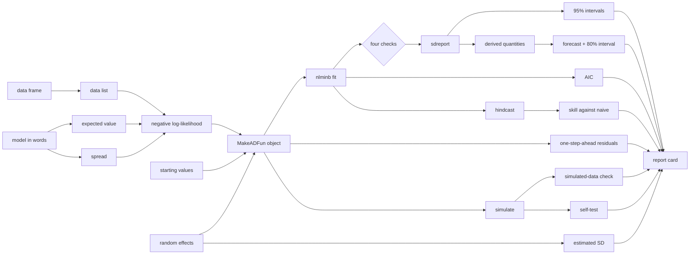

This page is the design record of the lesson, published as The Carpentries recommend for lesson developers.
The lesson was designed backwards: from the learners, to what they should be able to do, to how that is assessed (the model report card), to the exercises, and only then to the explanations.
Three candidate designs were judged on teaching, on statistical and RTMB correctness, and on how well they met the request for a cookbook; this lesson is the backward design, with the novice-first Quick Start and the task-first recipe cards of the other two grafted on.
Every number on this page was produced by running the lesson's code.

## Learner Profiles

The lesson is written for four fictional learners, described on the <a href="profiles.html">Learner Profiles</a> page:

- **Mira**, a stock assessment biologist, who needs reference points with intervals and a forecast that allows for falling productivity;
- **Tomás**, an MSc student, who needs a curve of his own with a random effect for each site;
- **Dana**, a biologist with an Indigenous fisheries organisation, who reviews forecasts made by others;
- **Sam**, a public health analyst learning alone from the website.

The lesson is novice-level for model fitting, not for R.

## Lesson Objectives

After the workshop, learners will be able to:

- **LO1 Write.** Write a negative log-likelihood function in R for a model described in words and one equation.
- **LO2 Fit and check.** Fit a model with RTMB, use four named checks to tell whether the fit can be used, and find the cause of a failed check in the troubleshooting table.
- **LO3 Report.** Report parameters and derived quantities with 95% confidence intervals on the natural scale, with units.
- **LO4 Random effects.** Add a random effect (over time or across groups) to a model and interpret its estimated standard deviation in words, including an estimate of zero.
- **LO5 Check the model.** Use one-step-ahead residuals and data simulated from a fitted model to identify what the model misses.
- **LO6 Compare.** Compare models fitted to the same rows with AIC, and state a choice using four written rules, including when AIC cannot decide.
- **LO7 Forecast and test.** Produce a forecast with an 80% prediction interval, and score competing models against a naive benchmark on past years.

These are seven objectives for about 11 hours of episodes.
A workshop can stop at two checkpoints and still be useful:

- after [Episode 7](../episodes/07-residuals.Rmd) (LO1 to LO4 and the residual part of LO5, for one stock);
- after [Episode 9](../episodes/09-model-selection.Rmd) (LO1 to LO6).

## The Report Card and Rubric

The end goal of the lesson is a model report card for one stock.
It appears three times:

- completed for Stellako in the [Introduction](../episodes/01-introduction.Rmd), as the target;
- one row at a time for Upper Pitt River in the "Your Turn" challenges, which learners keep in `report-card.R`;
- as a checklist in the [Capstone](../episodes/12-capstone.Rmd), where the "Done when..." column is the rubric.

Table: The model report card, with Stellako as the worked example.

| Row | Item | Done when... | Objective | Stellako (worked example) |
|--:|----|------------|----|--------------|
| 1 | Data | Stock, first and last brood year, number of years, spawner range with units, `S_new` (average spawners of the last four brood years) | (context) | 1948-2021, 74 years, spawners 9.2-240 thousand; `S_new` = 50 thousand (the average of the last four years is 51.7) |
| 2 | Fits usable | `$checks` shown for every model; any FALSE explained and fixed | LO2 | all four models pass all four checks |
| 3 | Estimates | alpha and S_max (S_half for Beverton-Holt) with 95% CI, natural scale, units | LO3 | alpha 10.8 recruits per spawner (7.9-14.7); S_max 122 thousand spawners (73-207) |
| 4 | Random effect | sd_walk in words; productivity in the first year, at its peak and in the last year; an SD near zero recognised and interpreted, its interval not reported | LO4 | sd_walk 0.13 (0.065-0.25): typical yearly change about 13%; productivity 12.5 (1948), 15.6 (1980), 3.8 (2021) recruits per spawner |
| 5 | Residuals | lag-1 correlation against 2/sqrt(n); QQ verdict; pattern over time; for each model | LO5 | Ricker lag-1 0.25 (limit 0.23), residuals +0.43 before 1990 and -0.95 after 2000; random walk -0.10; one outlier year (2005) in both |
| 6 | Simulation | share of simulations with lag-1 at least as large as the data's; self-test of the chosen model (medians against truth, refits that pass, SDs collapsing to zero) | LO5 | Ricker 0 of 200, random walk 12%; self-test: 50 of 50 refits pass, sd_walk collapses to zero in 11 of 50 |
| 7 | Comparison | AIC table on identical rows; a choice using the four rules; one sentence on what AIC cannot tell | LO6 | random walk best by 18.2 (Beverton-Holt), 19.9 (Ricker), 20.7 (Ricker + NPGO) |
| 8 | Forecast skill | hindcast from 2007 (bias, MAE, skill against naive, 80% coverage) for each candidate and the naive benchmark; one sentence | LO7 | random walk skill 0.79, bias -0.01, coverage 0.73; Ricker 1.22, +0.83, 0.60 |
| 9 | Forecast | median recruits for `S_new` with 80% prediction interval from the chosen model, units, the word "median" | LO7, LO3 | 148 thousand recruits (80% PI 55-397) from 50 thousand spawners |
| 10 | Conclusion | three sentences: which model, why (rows 5 to 8), main caveat | all | "Productivity has fallen from about 15 recruits per spawner around 1980 to about 4 since 2010. The random-walk model captures this: it passes the residual checks, is strongly preferred by AIC and forecasts better than the recent average. Its 80% intervals caught only 73% of past outcomes, so the forecast is less certain than its interval suggests." |
| 11 | Stretch | a new model combining two ideas, fitted, checked, added to rows 7 and 8 | LO1 | Beverton-Holt with random walk: AIC 177.7 (best by 0.6, a tie), skill 0.76 |

## Assessment Map

Each objective is practised at least twice before the capstone.
Challenge IDs are `E<episode>.C<challenge>`: E03.C2 means Episode 3, Challenge 2.
A Parsons problem gives learners shuffled lines of code to put in order; a faded example gives them code with blanks to fill in.

Table: Where each objective is assessed.

| Objective | Formative challenges | Upper Pitt River row | Capstone row |
|------|------------|------|-----|
| LO1 Write | E03.C2 Parsons problem, E03.C3 faded Beverton-Holt, E05.C2 faded S_rep, E10.C3 faded NPGO term | (Beverton-Holt used in row 7) | 11, and every model in rows 2 to 8 |
| LO2 Fit and check | E02.C1, E04.C1, E04.C2, E04.C3, E06.C2, E08.C1 Parsons problem | row 2 (E04.C4) | 2 |
| LO3 Report | E05.C1, E05.C3, E11.C1 | row 3 (E05.C4) | 3, 9 |
| LO4 Random effects | E06.C1, E06.C4, E08.C5, E10.C1, E10.C2 | row 4 (E06.C3) | 4 |
| LO5 Check the model | E02.C2, E07.C1, E07.C3, E08.C2, E08.C3 | rows 5, 6 (E07.C2, E08.C4) | 5, 6 |
| LO6 Compare | E02.C3, E09.C1, E09.C2, E09.C3, E09.C5, E10.C4 | row 7 (E09.C4) | 7 |
| LO7 Forecast and test | E02.C4, E11.C1, E11.C2, E11.C3, E11.C5 | rows 8, 9 (E11.C4) | 8, 9, 10 |

Episodes 1 to 11 have 48 challenges (one of them optional) in 585 minutes, 330 of them teaching: about one challenge every 7 minutes of teaching, plus a sticky-note checkpoint after every recipe ("Check it worked").
The capstone is one long applied assessment.

## Misconceptions and the Answer Plan

Every misconception below was confirmed by the review of the original workshop or by the runs made for this lesson.
Each has at least one multiple-choice distractor or one demonstration.

Table: Misconceptions, the evidence for them, and where the lesson targets them.

| # | Misconception | Evidence (from the lesson's own runs) | Targeted by |
|---|----------|--------------|------|
| M1 | Return the log-likelihood, not its negative | `opt$convergence` is 0 with the message "X-convergence (3)", `opt$objective` is `-Inf`, and the checks are TRUE FALSE FALSE FALSE | E03.C2, E04.C1 |
| M2 | `convergence == 0` means the fit is usable | the same output | E04.C1 |
| M3 | If the optimiser finished on flat ground, the standard errors are fine | two parameters that do one job: `finished` TRUE, `flat` TRUE, every standard error `NaN` | E04.C2 |
| M4 | Back-transform as exp(estimate) ± 1.96 SE | gives 122.2 to 123.3 instead of 73 to 207 thousand for Stellako's S_max | E05.C1 |
| M5 | A confidence band should contain most data points | the 95% band holds 24% of the Stellako points | E05.C3, E11.C1 |
| M6 | `exp()` of a log-scale forecast is the mean | median 148, mean 199 thousand recruits | E11.C2 |
| M7 | `random =` means "draw random numbers"; an SD at zero means the fit failed | Harrison: four checks TRUE, sd_walk 5e-6, AIC exactly 2.00 above the Ricker | E06.C1, E06.C4 |
| M8 | Observed-minus-fitted residuals are fine for random-effect models | conditional residuals have SD 0.96 and lag-1 correlation -0.17; one-step-ahead residuals have SD 1.00 and -0.10 | Episode 7 spoiler and keypoint |
| M9 | Models fitted to different rows can be compared by AIC | the Ricker on 1958-2021 has AIC 177.2 and appears to beat the random walk on 1948-2021 (178.3); on the same rows the walk wins by 17.6 | E09.C3 |
| M10 | Lower AIC means better forecasts | Upper Pitt River: AIC prefers the random walk by 11.8, but the Ricker's hindcast errors are slightly smaller (skill 0.78 against 0.82); Chilko and Birkenhead in the capstone (AIC and the hindcast choose different models), and Late Stuart (the lowest-AIC model forecasts no better than the recent-average benchmark) | E11.C4, capstone share-out |
| M11 | Changing `dat` after a fit is harmless | with the raw RTMB calls, `dat$S_new <- 150` after fitting silently changed `sdreport()`'s `mu_new` from 1.97 to 1.16 | Episode 4 spoiler (demonstration) |
| M12 | A covariate that lowers AIC is robust | pooled NPGO: AIC changes by -16.0 without year effects and +0.57 with them | E10.C4 |
| M13 | An SD estimated at zero proves there is no variation | self-test: 11 of 50 data sets simulated with sd_walk 0.13 gave an estimate of about zero | E06.C4 (option c), E08.C5 |
| M14 | `obj$simulate()` without arguments uses the fitted values | it uses the parameters evaluated last | Episode 8 caution |
| M15 | S_max is a carrying capacity | (terminology) | Episode 5 caution |
| M16 | AIC can compare a model of log(R/S) with a model of R | the two models describe different responses | E09.C5 |

**Answer plan for multiple-choice questions.**
If most learners pick one wrong answer, re-teach the misconception it names, using the evidence column.
If answers are spread out, go back to the last point everyone understood.
If almost everyone is right, move on.

## Concept Map

The concept map shows what each idea depends on, and where everything ends up: the report card.

The same map in words:

1. A data frame becomes a data list.
2. A model in words gives an expected value and a spread, which together form the negative log-likelihood.
3. With starting values, `MakeADFun()` builds an object that `nlminb()` fits, and four checks decide whether the fit can be used.
4. `sdreport()` then gives standard errors, 95% intervals and derived quantities.
5. Random effects feed the object and add an estimated standard deviation.
6. The object also gives one-step-ahead residuals and simulations; the simulations give a simulated-data check and a self-test.
7. Fits give AIC for model choice, and refits on past years give a hindcast, scored against the naive benchmark.
8. Derived quantities give the forecast with its 80% prediction interval.
9. All of these feed the report card.

## Decision Log: One Way per Task

The lesson is a cookbook: it teaches one recommended way to do each task, and no second method.
These are the decisions, and the evidence behind each.

Table: Design decisions and the evidence for them.

| Decision | What the lesson does | Evidence |
|-----|----------|--------------|
| One fitting function | `fit_model()` packages the Quick Start's three RTMB calls (`MakeADFun()`, `nlminb()`, `sdreport()`) and the four checks | It stops with a clear message when the negative log-likelihood is not a finite number at the starting values, raises the evaluation limits to 10 000, and restarts the optimiser once. All 76 single-stock fits (4 models on 19 stocks) pass all four checks |
| One rule for starting values | Typical values from the data (`start_ricker()`, `start_bh()`, `start_walk()`), with the random-walk SD started at 0.1 | Another rule reached a local optimum for Nadina (sd_walk about 0.036). With these starting values, Nadina and Harrison reach the boundary (sd_walk about 7e-6 and 5e-6), with AIC exactly 2.00 above the Ricker |
| Wald intervals (estimate ± 1.96 standard errors) on the estimation scale | `ci_table()` builds every 95% interval on the scale the parameter is estimated on, and back-transforms both ends of anything named `log_...` with `exp()`; the interval of an SD near zero, or of a very uncertain SD, is not reported | Adding ±1.96 log-scale standard errors to the back-transformed estimate instead (exp(4.81) ± 1.96 × 0.27) gives 122.2 to 123.3 thousand for S_max, instead of 73 to 207 (M4). Intervals for an SD near zero or a very uncertain SD are printed only as a warning sign and never reported (Harrison's sd_walk: 0 to `Inf`; the pooled sd_stock: 0.024 to 0.46); profile intervals are an optional spoiler (Episodes 6 and 10) |
| `ADREPORT()` for derived quantities | Derived quantities are computed inside the model function and reported with `ADREPORT()`; `REPORT()` is not taught | One function, `ci_table(m, "report")`, gives their intervals. `predict_recruits()` reads only the rows named `mu_new`. `obj$report()` without arguments returns values from the parameters evaluated last, a trap the lesson avoids |
| One-step-ahead residuals only | `osa_residuals()` for every model | Observed-minus-fitted residuals of the random walk have SD 0.96 and lag-1 correlation -0.17, against 1.00 and -0.10 for one-step-ahead residuals: they hide what the model misses (M8) |
| AIC for explanation, hindcasts for forecasting | `aic_table()` compares models on identical rows; `hindcast()` and `score_forecasts()` test forecasts against a naive benchmark | `aic_table()` stops unless every model was fitted to the same rows (M9). On Upper Pitt River, AIC prefers the random walk by 11.8 but the Ricker's hindcast errors are slightly smaller (M10) |
| One function per model | Each model is its own `nll_*` function; no `map` and no global switches in the core | `map` is a second way to write a nested model, so it is an optional spoiler in Episode 9. A global switch inside the function is also read by `obj$simulate()`, which then follows the switch's current value |
| Data passed through `fit_model()` | The fitted model keeps its own copy of the data and the recipe it was fitted with | With raw calls, `dat$S_new <- 150` after fitting silently changed `sdreport()`'s `mu_new` from 1.97 to 1.16 (M11). The stored recipe also makes refits for the self-test and the hindcast one line each |

## What Was Left Out of the Original Workshop

The lesson was developed from the materials of the RTMB workshop hosted by the Pacific Salmon Commission in November 2026 (slides and examples by Paul van Dam-Bates).
Topics from that workshop were left out when no row of the report card needs them.
Each was moved to the [Going Further](../learners/going-further.md) page or dropped.

Table: Topics of the original workshop that the lesson leaves out.

| Topic | Where it went |
|------------|------------|
| Derivative theory, finite differences, tapes and graphs | Dropped; Going Further points to the original workshop materials |
| The Laplace approximation and the delta method by hand | Dropped; Going Further points to the RTMB and TMB documentation and the original workshop materials |
| `DataEval`, the bootstrap, `checkConsistency()` | Dropped |
| GMRF and loop codings of AR(1) | Going Further: year effects correlated from year to year with `dautoreg()` |
| `ADjoint` and the Lambert W function | Dropped |
| A Newton solver inside a tape | Dropped |
| tmbstan | Going Further: Bayesian fitting of the same RTMB objects |
| Mixtures, latent factors and smoothers | Dropped |
| Multinomial residuals | Dropped |
| Age-structured forecasts | Going Further: forecasts by return year and age |
